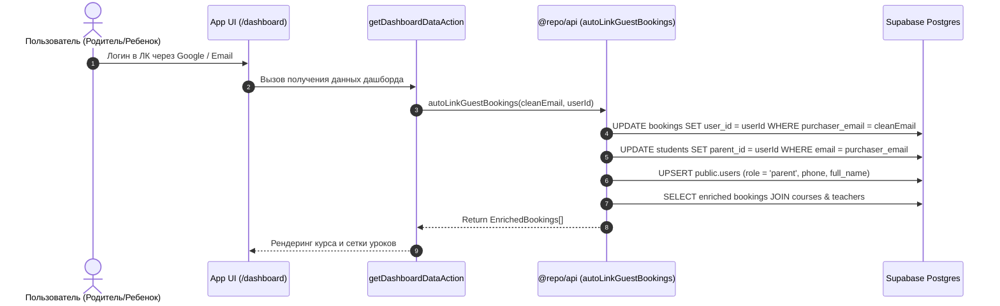

# 📱 Документация Личного Кабинета Atena School (`apps/app`)

## 📌 1. Назначение и Архитектурная Роль
Приложение Личного Кабинета (`apps/app`) является закрытой клиентской платформой для учеников и их родителей (`app.atenaschool.com`).

**Главные задачи приложения**:
1. **Дашборд Ученика и Родителя**: Просмотр купленных курсов, расписания 9 занятий, посещаемости и карточки ученика.
2. **Автоматическая Привязка Заказов**: Привязка анонимных/гостевых покупок, сделанных на лендинге, при 1-м входе пользователя.
3. **Разделение Ролей (`parent` vs `student`)**: Отображение соответствующих прав доступа в зависимости от авторизованного пользователя.
4. **Безопасность RLS (Row Level Security)**: Доступ исключительно к собственным заказам через валидацию JWT-токенов Supabase Auth.

---

## 📂 2. Структура Проекта (`apps/app/src`)

```
apps/app/src/
├── app/                      # Next.js App Router (Роуты Личного Кабинета)
│   ├── page.tsx              # Главная страница ЛК (Редирект на /dashboard)
│   ├── dashboard/            # Основной Дашборд
│   │   ├── page.tsx          # Карточки активных курсов, список уроков и статус оплаты
│   │   └── bookings/[id]/    # Детальный просмотр конкретного бронирования и занятий
│   ├── autenticazione/       # Маршруты аутентификации
│   │   ├── accedi/           # Страница входа (Magic Link / Google Auth)
│   │   ├── callback/         # Auth Callback обработки сессий
│   │   └── reimposta-password/# Сброс и восстановление пароля
│   └── actions/              # Server Actions
│       └── dashboard.ts      # Вызов getDashboardDataAction и getBookingLessonsAction
├── features/                 # Бизнес-модули интерфейса
│   ├── auth/                 # Компоненты авторизации и формы входа
│   └── dashboard/            # Компоненты Дашборда (BookingCard, LessonList, UserProfile)
│       └── services/         # dashboardService.ts (Реэкспорт из @repo/api)
└── lib/                      # Клиенты и Утилиты
    ├── supabase/             # SSR-клиент Supabase
    └── utils.ts              # Хелперы UI и привязки
```

---

## 👥 3. Логика Авторизации и Авто-Привязки (`autoLinkGuestBookings`)



---

## 🔒 4. Разграничение Прав Доступа (RLS Policies)

Таблица `public.bookings` защищена политикой PostgreSQL RLS:
```sql
CREATE POLICY "Allow users to read own bookings" ON public.bookings
FOR SELECT TO authenticated
USING (
  (auth.uid() = user_id) OR 
  (LOWER(student_email) = LOWER(auth.jwt() ->> 'email')) OR 
  (LOWER(purchaser_email) = LOWER(auth.jwt() ->> 'email'))
);
```

* **Родитель (`role = 'parent'`)**: Находит свои заказы по `purchaser_email` и видит все курсы своих детей.
* **Ребенок (`role = 'student'`)**: Находит свои заказы по `student_email` и видит свое индивидуальное расписание.

---

## 🔗 5. Связь с Серверным Ядром `@repo/api`

Приложение `apps/app` не содержит собственной продублированной сервисной логики. Модуль [`apps/app/src/features/dashboard/services/dashboardService.ts`](file:///Users/krimson/PROJECTS/atena_school/apps/app/src/features/dashboard/services/dashboardService.ts) выполняет прямой реэкспорт функций из центрального пакета `@repo/api`.
