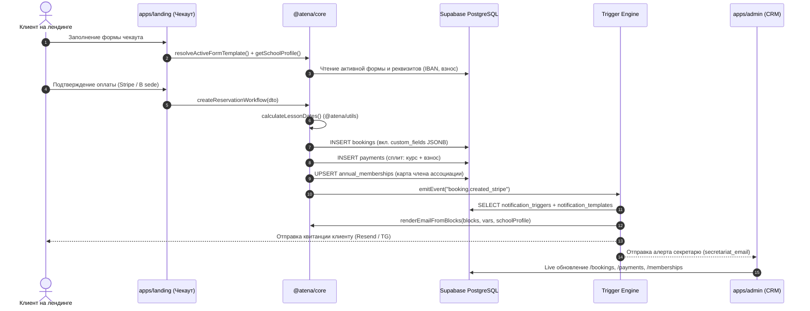

# 🗺 Карта Архитектуры Atena School (Developer Guide)

> **Главный принцип:** `@atena/core` — **Единственный Источник Правды (Single Source of Truth)** для всей бизнес-логики.  
> Next.js Route Handlers и NestJS — это **тонкие контроллеры (Thin Controllers)**, вызывающие чистые функции ядра.

---

## 📦 1. Структура Пакетов и Приложений

```
atena_school/
├── packages/
│   ├── core/           # 🧠 МОЗГ СИСТЕМЫ: бизнес-логика чекаута, взносов, триггеров, писем
│   ├── api-types/      # 📐 Единые TypeScript типы, DTO, схемы и энумы для всех сервисов
│   ├── utils/          # ⚙️ Чистые алгоритмы: calculateLessonDates, форматирование валют, дат
│   └── validators/     # 🛡 Схемы валидации Zod (формы, чекаут, промокоды)
│
├── apps/
│   ├── landing/        # 🌐 Публичный сайт и чекаут (Next.js 15, SSR, SEO, Server Actions / Route Handlers)
│   ├── app/            # 🎓 Личный кабинет студента (Next.js 15, расписание, бронирования, контакты)
│   ├── admin/          # 💼 CRM Секретаря (Vite React SPA, управление бронями, формами, шаблонами, школой)
│   └── backend/        # 🚀 REST API сервер (NestJS, модули для CRM и фоновых задач)
│
└── supabase/
    └── migrations/     # 🗄 Миграции PostgreSQL (school_profiles, form_templates, notification_triggers, ...)
```

---

## 🔄 2. Сквозной Поток Данных: От Чекаута до CRM



---

## 📁 3. Где искать нужную логику

| Если нужно изменить / подебажить... | Где находится файл? | Что там происходит? |
| :--- | :--- | :--- |
| **Логика бронирования и платежей** | `packages/core/src/checkout/reservation.service.ts` | Сплит платежей, запись в `bookings` и `payments` |
| **Генерация дат уроков** | `packages/utils/src/bookingScheduler.ts` | Функция `calculateLessonDates()` — единственный генератор уроков |
| **Проверка и сумма взноса (€30)** | `packages/core/src/checkout/fee.service.ts` | Проверка `annual_memberships` по Codice Fiscale |
| **Реквизиты школы / Бренд / IBAN** | `packages/core/src/system/school-profile.service.ts` | Чтение и запись `school_profiles` |
| **Конструктор форм и кастомные поля** | `packages/core/src/system/form-resolver.service.ts` | Функция `resolveActiveFormTemplate()` |
| **Компилятор писем и Telegram** | `packages/core/src/notifications/block-compiler.ts` | `renderEmailFromBlocks()`, подстановка `schoolProfile` и переменных |
| **Движок триггеров и условий** | `packages/core/src/notifications/notification.service.ts` | `processNotificationTriggers()`, сопоставление `conditions` |
| **CRM интерфейс админки** | `apps/admin/src/features/` | UI конструкторов (`forms`, `notifications`, `bookings`, `memberships`) |

---

## ⏱ 4. Чек-лист Дебага за 60 секунд

1. **Если изменились реквизиты школы (IBAN, телефон, адрес):**
   * Проверь строку в таблице `school_profiles` в Supabase.
   * Убедись, что компонент вызывает `getSchoolProfile()` / `useSchoolProfile()`.
2. **Если письмо уходит со старым текстом или не тому получателю:**
   * Открой в CRM раздел `/notifications` ➔ вкладку **"Log & Storico Invii"**.
   * Проверь статус отправки, адресата и полезную нагрузку (`payload`).
3. **Если не появляются кастомные поля на чекауте:**
   * Проверь в CRM раздел `/forms` ➔ активна ли форма (`is_active: true`) и включены ли поля (`is_enabled: true`).
4. **Если не создались уроки:**
   * Проверь параметры `schedule_days`, `start_time`, `end_time` у курса.
