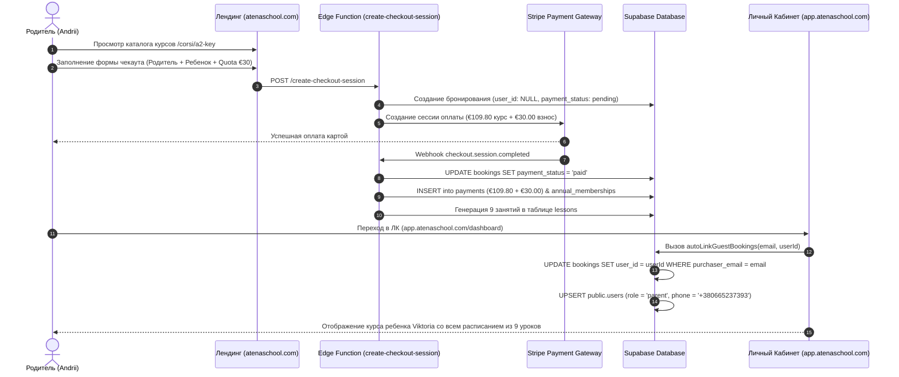

# 🏛️ Главный Архитектурный Обзор Системы Atena School

## 📌 1. Архитектура Монорепозитория
Проект Atena School построен на базе монорепозитория **Turborepo** с использованием **pnpm workspaces**.

```
atena_school/
├── apps/
│   ├── landing/              # Публичный Лендинг & Чекаут (atenaschool.com)
│   └── app/                  # Личный Кабинет Студента и Родителя (app.atenaschool.com)
├── packages/
│   └── api/                  # Единое Серверное Ядро (@repo/api)
└── docs/                     # Полная Системная Документация
    ├── ARCHITECTURE_OVERVIEW.md       # Главный архитектурный обзор (Этот файл)
    ├── LANDING_SPECIFICATION.md       # Спецификация Лендинга и Чекаута
    └── APP_DASHBOARD_SPECIFICATION.md # Спецификация Личного Кабинета
```

---

## 🔗 2. Связывающее Единое Ядро (`packages/api` ➔ `@repo/api`)

Все приложения системы взаимодействуют с единым серверным пакетом `@repo/api`:

```mermaid
graph TD
    Landing[apps/landing: atenaschool.com] -->|Импорт утилит расписания| Core[@repo/api: packages/api]
    App[apps/app: app.atenaschool.com] -->|Импорт сервисов дашборда| Core
    Core -->|Запросы с RLS и авто-привязкой| DB[(Supabase Postgres DB)]
    Edge[Supabase Edge Functions] -->|Управление транзакциями| DB
```

### Связанные документы спецификации:
1. 🛍️ [**Документация Лендинга (`LANDING_SPECIFICATION.md`)**](file:///Users/krimson/PROJECTS/atena_school/docs/LANDING_SPECIFICATION.md) — Описание SEO, чекаута, формы оплаты Stripe и микроразметки Schema.org.
2. 📱 [**Документация Личного Кабинета (`APP_DASHBOARD_SPECIFICATION.md`)**](file:///Users/krimson/PROJECTS/atena_school/docs/APP_DASHBOARD_SPECIFICATION.md) — Описание авто-привязки заказов `autoLinkGuestBookings`, управления ролями `parent`/`student` и сетки уроков.

---

## 🔄 3. Единый Поток Данных (End-to-End User Flow)



---

## 🛡️ 4. Главные Принципы Архитектуры

1. **Strict Separation of Concerns**: Лендинг отвечaет только за продажу и SEO. ЛК отвечает только за обучение и расписание.
2. **Zero Code Duplication**: Вся общая логика вынесена в `@repo/api`. Никакого дублирования сервисов.
3. **Zero-Trust Financial Security**: Окончательный расчет стоимости и годовых взносов выполняется строго на сервере в Edge Function.
4. **Automatic Account Binding**: Независимо от того, когда пользователь вошел в аккаунт — до или после оплаты — система автоматически связывает бронирования и карточки учеников.
