# Atena School — Database Schema Specification

> **Target Audience**: Software Engineers, Database Architects, and Autonomous AI Agents.  
> **Database Engine**: PostgreSQL (Supabase)  
> **Schema**: `public` (Integrates with Supabase `auth.users`)  
> **Last Updated**: July 2026  

---

## 1. Executive Summary & Architecture Overview

The Atena School database schema is designed following Third Normal Form (3NF) principles, providing a flexible foundation for web landing pages, student/teacher dashboards, payment processing via Stripe, and enterprise CRM/CMS integrations.

### Key Architectural Highlights
1. **Unified Identity & Role Inheritance**: Supabase Auth (`auth.users`) synchronizes automatically with `public.users` via PostgreSQL triggers with `SECURITY DEFINER` privileges. User roles extend identity via `public.teachers` and `public.students`.
2. **Parent-Student Hierarchy**: Supports purchases made by parents for their children. `public.users` stores parent/purchaser accounts, while `public.students` maintains individual student profiles linked via `parent_id` and student Google accounts via `student_user_id`.
3. **Canonical Annual Membership Registry**: `public.annual_memberships` serves as the single server-authoritative source of truth for student annual registration fees (€30.00) for each academic year (e.g. `'2026/2027'`). Server actions and Edge Functions perform zero-trust checks against this table to enforce accurate fee calculations.
4. **Dynamic Duration & Schedule Calculations**: Legacy static strings (e.g., `duration`) are eliminated. Course duration and frequency are stored as clean numeric primitives (`lesson_duration_minutes`, `lessons_per_week`, `total_hours`, `schedule_days`) and formatted dynamically on client applications. Unscheduled/flexible time slots are cleanly stored as SQL `NULL` values in `booking_time`.
5. **Automated Student Enrollment**: A PostgreSQL trigger `handle_booking_student_enrollment()` automatically creates/updates an active student record in `public.students` when a booking is created or updated, linking `bookings.student_id`.
6. **Decoupled Order & Calendar System**: Purchasing a course creates a snapshot entry in `public.bookings`. Individual calendar events are stored separately in `public.lessons` (1:N relationship with `ON DELETE CASCADE`), allowing independent rescheduling, attendance tracking, and Google Meet online links without mutating order data.
7. **Multi-Status Ledger**: `public.bookings` clearly separates financial status (`payment_status`), subscription lifecycle (`booking_status`), and calendar coordination (`scheduling_status`).
8. **Lead Management**: Inbound customer inquiries from the website are captured in `public.contact_messages` with CRM processing status (`status`, `notes`).

---

## 2. Entity-Relationship Diagram (ERD)

```mermaid
erDiagram
    users ||--o| teachers : "has profile (PK/FK)"
    users ||--o{ students : "parent of (parent_id)"
    users ||--o| students : "student account (student_user_id)"
    users ||--o{ bookings : "purchased by (purchaser_id/email)"
    
    courses ||--o{ course_teachers : "taught by"
    teachers ||--o{ course_teachers : "assigned to"
    
    courses ||--o{ bookings : "booked in"
    students ||--o{ bookings : "enrolled in"
    
    bookings ||--o{ payments : "paid via (1:N)"
    bookings ||--o{ lessons : "generates (1:N)"
    courses ||--o{ lessons : "course template"
    teachers ||--o{ lessons : "instructs"
    
    lessons ||--o{ attendance_records : "attendance journal (1:N)"
    students ||--o{ attendance_records : "student presence"
    bookings ||--o{ attendance_records : "booking reference"
    
    students ||--o{ annual_memberships : "membership year (Quota €30)"
    bookings ||--o{ annual_memberships : "purchased in booking"

    users {
        uuid id PK "gen_random_uuid()"
        timestamptz created_at "NOT NULL DEFAULT now()"
        timestamptz updated_at "NOT NULL DEFAULT now()"
        text email UK "NOT NULL, UNIQUE"
        text full_name "NOT NULL"
        smallint role "1=STUDENT, 2=TEACHER, 3=ADMIN, 4=PARENT, 5=SECRETARY, 6=SUPERADMIN"
        boolean is_active "NOT NULL DEFAULT true"
        text phone "nullable"
        text tax_code "Codice Fiscale (nullable)"
        text sdi_code "Codice SDI per Fattura (nullable)"
        text pec_email "Posta Elettronica Certificata (nullable)"
        text avatar_url "nullable"
        text notes "nullable"
    }

    teachers {
        uuid teacher_id PK,FK "refs users.id ON DELETE CASCADE"
        timestamptz created_at "NOT NULL DEFAULT now()"
        timestamptz updated_at "NOT NULL DEFAULT now()"
        text full_name "NOT NULL"
        boolean is_active "NOT NULL DEFAULT true"
        text experience "Bio / Qualifiche"
        text photo_url "nullable"
        bigint color_value "Calendar HEX/ARGB color"
        date hire_date "CURRENT_TIMESTAMP"
        date birth_date "nullable"
        uuid contract_id "nullable"
    }

    students {
        uuid id PK "gen_random_uuid()"
        timestamptz created_at "NOT NULL DEFAULT now()"
        timestamptz updated_at "NOT NULL DEFAULT now()"
        text first_name "NOT NULL"
        text last_name "NOT NULL"
        text full_name "GENERATED ALWAYS / Synced"
        text email "nullable"
        text phone "nullable"
        text tax_code "Codice Fiscale dello Studente"
        date birth_date "Data di Nascita"
        text photo_url "nullable"
        smallint language_level "1=A1, 2=A2, 3=B1, 4=B2, 5=C1, 6=C2, 7=UNKNOWN"
        smallint status "1=LEAD, 2=ACTIVE, 3=PAUSED, 4=ARCHIVED"
        boolean annual_fee_paid "true if Quota €30 paid this year"
        timestamptz annual_fee_paid_at "Data pagamento quota"
        timestamptz registration_date "Data prima registrazione"
        uuid parent_id FK "refs users.id (ON DELETE SET NULL)"
        uuid student_user_id FK "refs users.id (ON DELETE SET NULL)"
        uuid contract_id "nullable"
    }

    courses {
        uuid id PK "gen_random_uuid()"
        timestamptz created_at "NOT NULL DEFAULT now()"
        timestamptz updated_at "NOT NULL DEFAULT now()"
        text name "Codename / English Title"
        text title_it "Titolo Italiano per Landing"
        text category "Lingue, Informatica, Doposcuola, Certificazioni"
        text description "Descrizione completa"
        decimal price "NOT NULL, DECIMAL(10,2)"
        smallint billing_type "1=FULL_UPFRONT, 2=MONTHLY_SUBSCRIPTION, 3=INSTALLMENTS"
        smallint status "1=ACTIVE, 2=DRAFT, 3=ARCHIVED"
        smallint format "1=INDIVIDUAL, 2=GROUP, 3=INTENSIVE, 4=CUSTOM"
        smallint schedule_type "1=FIXED, 2=FLEXIBLE, 3=RECURRING, 4=INTENSIVE"
        integer lesson_duration_minutes "Default 60 min"
        smallint total_lessons "Default 10 / 20 / 30"
        jsonb schedule_days "Array di giorni ISO [1, 3] (Lun/Mer)"
        time start_time "Orario inizio lezione (09:00)"
        time end_time "Orario fine lezione (10:00)"
        date start_date "Data inizio ciclo corso"
        date end_date "Data fine stimata ciclo"
        integer max_students "Capienza massima per classi di gruppo"
        integer current_enrolled "Contatore iscritti attivi"
        text image_url "Locandina corso"
    }

    course_teachers {
        uuid course_id PK,FK "refs courses.id ON DELETE CASCADE"
        uuid teacher_id PK,FK "refs teachers.teacher_id ON DELETE CASCADE"
        timestamptz created_at "NOT NULL DEFAULT now()"
        boolean is_primary "Docente titolare del corso"
    }

    bookings {
        uuid id PK "gen_random_uuid()"
        timestamptz created_at "NOT NULL DEFAULT now()"
        timestamptz updated_at "NOT NULL DEFAULT now()"
        uuid course_id FK "refs courses.id ON DELETE RESTRICT"
        uuid student_id FK "refs students.id ON DELETE SET NULL"
        text purchaser_name "Nome e Cognome acquirente"
        text purchaser_email "Email acquirente"
        text purchaser_phone "Telefono acquirente"
        text purchaser_tax_code "Codice Fiscale acquirente (Fattura)"
        text student_name "Nome e Cognome studente effettivo"
        text student_email "Email studente"
        text student_phone "Telefono studente"
        text student_tax_code "Codice Fiscale studente"
        boolean is_for_child "true se il genitore acquista per il figlio"
        decimal total_amount "NOT NULL, DECIMAL(10,2)"
        decimal amount_paid "Somma totale incassata, DECIMAL(10,2)"
        smallint payment_status "1=RESERVED, 2=PAID, 3=PARTIAL, 4=FAILED, 5=REFUNDED"
        smallint status "1=ACTIVE, 2=CONFIRMED, 3=CANCELLED, 4=COMPLETED"
        smallint scheduling_status "1=PENDING, 2=SCHEDULED, 3=IN_PROGRESS, 4=COMPLETED"
        smallint payment_method "1=STRIPE, 2=CASH, 3=BANK_TRANSFER, 4=POS"
        smallint billing_scheme "1=FULL, 2=INSTALLMENTS, 3=SUBSCRIPTION"
        text stripe_session_id "Stripe Checkout Session ID"
        text stripe_payment_intent_id "Stripe PI ID"
        text stripe_customer_id "Stripe Customer ID"
        text course_name "Snapshot nome corso"
        decimal course_price "Snapshot prezzo corso"
        integer total_lessons "Snapshot numero lezioni previste"
        text notes "Note amministrative"
    }

    payments {
        uuid id PK "gen_random_uuid()"
        timestamptz created_at "NOT NULL DEFAULT now()"
        timestamptz updated_at "NOT NULL DEFAULT now()"
        uuid booking_id FK "refs bookings.id ON DELETE RESTRICT"
        decimal amount "NOT NULL, DECIMAL(10,2)"
        smallint currency "1=EUR, 2=USD, 3=GBP"
        smallint method "1=STRIPE, 2=CASH, 3=BANK_TRANSFER, 4=POS"
        smallint type "1=PAYMENT (Corso), 2=REGISTRATION_FEE (Quota €30), 3=REFUND"
        smallint status "1=SUCCEEDED, 2=PENDING, 3=FAILED, 4=REFUNDED"
        smallint provider "1=STRIPE, 2=MANUAL"
        text stripe_payment_intent_id "Stripe PI ID"
        text stripe_charge_id "Stripe Ch ID"
        text receipt_url "Link ricevuta / Fattura Stripe"
        text notes "Note di pagamento"
    }

    annual_memberships {
        uuid id PK "gen_random_uuid()"
        timestamptz created_at "NOT NULL DEFAULT now()"
        timestamptz updated_at "NOT NULL DEFAULT now()"
        uuid student_id FK "refs students.id ON DELETE CASCADE"
        uuid booking_id FK "refs bookings.id ON DELETE SET NULL"
        integer year "Anno associativo (es. 2026)"
        decimal fee_amount "30.00 EUR"
        smallint status "1=ACTIVE, 2=EXPIRED, 3=CANCELLED"
        date start_date "Data inizio validità"
        date end_date "31 Dicembre dell'anno in corso"
        text notes "Note associazione"
    }

    lessons {
        uuid id PK "gen_random_uuid()"
        timestamptz created_at "NOT NULL DEFAULT now()"
        timestamptz updated_at "NOT NULL DEFAULT now()"
        uuid booking_id FK "refs bookings.id ON DELETE CASCADE"
        uuid course_id FK "refs courses.id ON DELETE SET NULL"
        uuid student_id FK "refs students.id ON DELETE SET NULL"
        uuid teacher_id FK "refs teachers.teacher_id ON DELETE SET NULL"
        timestamptz starts_at "Data e ora inizio lezione"
        timestamptz ends_at "Data e ora fine lezione"
        smallint status "1=SCHEDULED, 2=COMPLETED, 3=CANCELLED, 4=RESCHEDULED, 5=NO_SHOW"
        smallint attendance "1=PENDING, 2=PRESENT, 3=ABSENT, 4=LATE, 5=EXCUSED"
        smallint location_type "1=IN_PERSON, 2=ONLINE, 3=HYBRID"
        text meeting_link "Link Google Meet / Zoom per lezioni online"
        text homework "Compiti assegnati"
        text teacher_notes "Note private del docente"
        integer reschedule_count "Contatore riprogrammazioni"
        timestamptz rescheduled_at "Data ultima riprogrammazione"
    }

    attendance_records {
        uuid id PK "gen_random_uuid()"
        timestamptz created_at "NOT NULL DEFAULT now()"
        timestamptz updated_at "NOT NULL DEFAULT now()"
        uuid lesson_id FK "refs lessons.id ON DELETE CASCADE"
        uuid student_id FK "refs students.id ON DELETE SET NULL"
        uuid booking_id FK "refs bookings.id ON DELETE SET NULL"
        smallint status "1=PENDING, 2=PRESENT, 3=ABSENT, 4=LATE, 5=EXCUSED"
        text marked_by "ID o Nome dell'utente/docente che ha registrato la presenza"
        timestamptz marked_at "Timestamp marcatura presenza"
        text notes "Note presenza (es. 'Uscito 15 minuti prima')"
    }

    contact_messages {
        uuid id PK "gen_random_uuid()"
        timestamptz created_at "NOT NULL DEFAULT now()"
        timestamptz updated_at "NOT NULL DEFAULT now()"
        text first_name "Nome del contatto"
        text last_name "Cognome del contatto"
        text email "Email"
        text phone "Telefono"
        text interest "Corso o argomento di interesse"
        text message "Messaggio inviato dal form"
        smallint status "1=NEW, 2=IN_PROGRESS, 3=RESOLVED, 4=ARCHIVED"
        text notes "Note del team di segreteria"
    }

    stripe_webhook_events {
        uuid id PK "gen_random_uuid()"
        timestamptz created_at "NOT NULL DEFAULT now()"
        text event_id UK "Stripe Event ID (evt_xxx) UNIQUE"
        text event_type "checkout.session.completed, payment_intent.succeeded..."
        jsonb payload "Corpo JSON completo dell'evento Stripe"
        boolean processed "true se gestito con successo"
        timestamptz processed_at "Data e ora elaborazione"
        text error "Eventuale messaggio di errore di elaborazione"
    }

    app_settings {
        text key PK "Parametro di configurazione (es. stripe_live_mode)"
        jsonb value "Valore dinamico JSONB"
        text description "Descrizione del parametro"
        timestamptz updated_at "NOT NULL DEFAULT now()"
    }
```




---

## 3. Detailed Table Specifications

### 3.1 `public.users`

Serves as the primary public identity profile table for all registered accounts (parents, adult students, teachers, admins).

| Column | Data Type | Nullable | Default | Description |
|---|---|:---:|---|---|
| **`id`** | `uuid` | NO | *None* | Primary Key. Matches `auth.users(id)` 1:1. |
| **`email`** | `text` | NO | *None* | Primary email address. |
| **`first_name`** | `text` | NO | `''` | User's first name. |
| **`last_name`** | `text` | NO | `''` | User's last name. |
| **`full_name`** | `text` | YES | `NULL` | Full display name (e.g., `"Mario Rossi"`). |
| **`role`** | `text` | NO | `'student'` | Access role: `'student'`, `'teacher'`, `'admin'`, `'staff'`. |
| **`is_active`** | `boolean` | NO | `true` | Account state flag. If `false`, access is blocked. |
| **`phone`** | `varchar` | YES | `NULL` | Contact phone number. |
| **`avatar_url`** | `text` | YES | `NULL` | URL to user's profile avatar image. |
| **`tax_code`** | `text` | YES | `NULL` | Italian Tax Code (*Codice Fiscale*). |
| **`notes`** | `text` | YES | `NULL` | Internal administrative notes. |
| **`created_at`** | `timestamptz` | NO | `CURRENT_TIMESTAMP` | Account creation timestamp. |
| **`updated_at`** | `timestamptz` | YES | `now()` | Last profile update timestamp. |

#### Database Triggers on `public.users` & `auth.users`
1. **`on_auth_user_created`**: Triggers `EXECUTE FUNCTION handle_new_user()`. Automatically inserts a row into `public.users` upon signup in Supabase Auth with `SECURITY DEFINER` privileges, setting role strictly to `'student'`. Guest bookings and student profile linking occur only if `email_confirmed_at IS NOT NULL` (e.g. OAuth providers).
2. **`on_email_confirmed`**: Triggers `EXECUTE FUNCTION handle_email_confirmed()`. Fires `AFTER UPDATE ON auth.users WHEN (OLD.email_confirmed_at IS NULL AND NEW.email_confirmed_at IS NOT NULL)` to sync confirmed `auth.users.email` to `public.users.email` and safely link guest `public.bookings` and `public.students` profiles only after cryptographic verification of email ownership.
3. **`enforce_user_role_protection`**: Triggers `EXECUTE FUNCTION check_user_update()`. Restricts modifications to `role`, `is_active`, `notes`, and direct `email` column updates strictly to users with `'admin'` privileges (users must use standard Supabase Auth verification flows to change email).
4. **`on_public_user_deleted`**: Triggers `EXECUTE FUNCTION handle_deleted_user()`. Deletes corresponding row in `auth.users` when a public user profile is removed.

#### Row Level Security (RLS) Policies on `public.users`
- **`users_select_policy`**: `FOR SELECT TO authenticated USING ((id = auth.uid()) OR (get_user_role() = 'admin') OR (get_user_role() = 'teacher' AND role = 'student'))`.
- **`users_update_policy`**: `FOR UPDATE TO authenticated USING ((id = auth.uid()) OR (get_user_role() = 'admin'))` (Modification of `role`, `is_active`, `notes`, and `email` is strictly enforced by `check_user_update()`).
- **`users_delete_policy`**: Restricted strictly to `'admin'` role.

---

### 3.2 `public.teachers`

Extends `public.users` for accounts where `role = 'teacher'`.

| Column | Data Type | Nullable | Default | Description |
|---|---|:---:|---|---|
| **`teacher_id`** | `uuid` | NO | *None* | Primary Key & Foreign Key -> `users(id)` ON DELETE CASCADE. |
| **`full_name`** | `text` | YES | `NULL` | Teacher's public display name. |
| **`experience`** | `text` | YES | `NULL` | Summary of academic/teaching experience. |
| **`status`** | `text` | NO | `'active'` | Employment status: `'active'`, `'on_leave'`, `'inactive'`. |
| **`hire_date`** | `date` | NO | `CURRENT_TIMESTAMP` | Date teacher joined Atena School. |
| **`birth_date`** | `date` | YES | `NULL` | Teacher's date of birth. |
| **`photo_url`** | `text` | YES | `NULL` | URL to teacher photo. |
| **`contract_id`** | `uuid` | YES | `NULL` | FK -> `documents(id)`. Employment contract reference. |
| **`color_value`** | `bigint` | YES | `4279899379` | Color identifier for calendar rendering. |

---

### 3.3 `public.students`

Stores individual student profile cards for school CRM tracking. Linked to parent/purchaser via `parent_id` and student Google login via `student_user_id`.

| Column | Data Type | Nullable | Default | Description |
|---|---|:---:|---|---|
| **`id`** | `uuid` | NO | `gen_random_uuid()` | Primary Key. |
| **`parent_id`** | `uuid` | YES | `NULL` | Foreign Key -> `users(id)` ON DELETE SET NULL. Parent/purchaser user account. |
| **`student_user_id`**| `uuid` | YES | `NULL` | Foreign Key -> `users(id)` ON DELETE SET NULL. Student's own Google/Auth user account. |
| **`first_name`** | `text` | YES | `NULL` | Student's first name. |
| **`last_name`** | `text` | YES | `NULL` | Student's last name. |
| **`full_name`** | `text` | YES | `NULL` | Student's full display name. |
| **`email`** | `text` | YES | `NULL` | Student's personal email address. |
| **`birth_date`** | `date` | YES | `NULL` | Student's date of birth. |
| **`photo_url`** | `text` | YES | `NULL` | Student photo for CRM UI. |
| **`language_level`** | `text` | NO | `'A1'` | CEFR level: `'A1'`, `'A2'`, `'B1'`, `'B2'`, `'C1'`, `'C2'`. |
| **`status`** | `text` | NO | `'active'` | Academic status: `'active'`, `'inactive'`, `'paused'`, `'graduated'`. |
| **`registration_date`**| `date` | NO | `CURRENT_TIMESTAMP` | Date student enrolled / purchased first course. |
| **`contract_id`** | `uuid` | YES | `NULL` | FK -> `documents(id)`. Signed enrollment agreement. |
| **`annual_fee_paid`** | `boolean` | YES | `false` | Quick boolean flag indicating if annual fee is settled. |
| **`annual_fee_paid_at`** | `timestamptz` | YES | `NULL` | Timestamp when annual fee was paid. |

#### Database Trigger on `public.students`
- **`trg_sync_annual_membership_students`**: Executes `sync_annual_membership_from_students()`. Automatically creates an active membership in `public.annual_memberships` when `annual_fee_paid` is set to `true`.

---

### 3.4 `public.annual_memberships`

Canonical single source of truth for student annual registration fees (€30.00) scoped by academic year.

| Column | Data Type | Nullable | Default | Description |
|---|---|:---:|---|---|
| **`id`** | `uuid` | NO | `gen_random_uuid()` | Primary Key. |
| **`tax_code`** | `text` | YES | `NULL` | Italian Tax Code (*Codice Fiscale*, normalized uppercase). Primary anti-abuse anchor. |
| **`email`** | `text` | YES | `NULL` | Student or parent email address (normalized lowercase). |
| **`phone`** | `text` | YES | `NULL` | Contact phone number. |
| **`academic_year`**| `text` | NO | `'2026/2027'` | Academic year identifier (e.g. `'2026/2027'`). |
| **`status`** | `text` | NO | `'active'` | Membership status (`'active'`, `'expired'`, `'refunded'`). |
| **`student_id`** | `uuid` | YES | `NULL` | Foreign Key -> `students(id)` ON DELETE SET NULL. |
| **`user_id`** | `uuid` | YES | `NULL` | Foreign Key -> `users(id)` ON DELETE SET NULL. |
| **`booking_id`** | `uuid` | YES | `NULL` | Foreign Key -> `bookings(id)` ON DELETE SET NULL. Original booking reference. |
| **`paid_at`** | `timestamptz` | NO | `now()` | Timestamp when fee was settled. |
| **`expires_at`** | `timestamptz` | NO | `'2027-08-31 23:59:59+00'` | Expiration timestamp of the academic year. |
| **`created_at`** | `timestamptz` | NO | `now()` | Record creation timestamp. |

#### Row Level Security (RLS) Policies on `public.annual_memberships`
- **RLS Enabled**: `ALTER TABLE public.annual_memberships ENABLE ROW LEVEL SECURITY;`
- **`Users can view own annual_memberships`**: `FOR SELECT USING (auth.uid() = user_id)` (Users can view their own membership status).
- **`Admins have full access on annual_memberships`**: `FOR ALL USING (role = 'admin')` (Full administrative access).

---

### 3.5 `public.courses`

The master catalog of courses, certifications, and educational services offered by Atena School.

| Column | Data Type | Nullable | Default | Description |
|---|---|:---:|---|---|
| **`id`** | `uuid` | NO | `gen_random_uuid()` | Primary Key. |
| **`name`** | `text` | NO | *None* | Course title (e.g., `"C1 Advanced"`, `"EIPASS 7 Moduli User"`). |
| **`category`** | `text` | NO | *None* | Course category: `'languages'`, `'Certipass'`, `'academic'`. |
| **`price`** | `numeric` | NO | *None* | Base course price in EUR (e.g., `120.00`). |
| **`status`** | `text` | NO | `'active'` | Publication state: `'active'`, `'published'`, `'draft'`. |
| **`course_format`** | `text` | YES | `NULL` | Format classification: `'group'`, `'private'`, `'certification'`. |
| **`schedule_type`** | `text` | YES | `'fixed'` | Scheduling logic: `'fixed'` (set timetable) or `'flexible'` (da concordare). |
| **`lessons_per_week`** | `integer` | YES | `NULL` | Weekly lesson count (e.g., `2` for C1, `3` for C2). |
| **`lesson_duration_minutes`**| `integer` | YES | `NULL` | Duration of each lesson in minutes (e.g., `60`, `75`). |
| **`total_hours`** | `integer` | YES | `NULL` | Total course duration in hours (`30` for EIPASS, `NULL` for standard). |
| **`total_lessons`** | `integer` | YES | `NULL` | Fixed total lesson quota (`1` for Single Private, `10` for Package 10). |
| **`schedule_days`** | `ARRAY` | YES | `NULL` | Array of 0-based weekday indices (`[1, 3]` = Mon & Wed). |
| **`start_time`** | `text` | YES | `NULL` | Daily start time string (e.g., `"15:00"`). |
| **`end_time`** | `text` | YES | `NULL` | Daily end time string (e.g., `"16:15"`). |
| **`teacher_id`** | `uuid` | YES | `NULL` | FK -> `teachers(teacher_id)`. Assigned lead teacher. |
| **`photo_url`** | `text` | YES | `NULL` | Public image URL in Supabase Storage `courses_images`. |
| **`description`** | `text` | YES | `NULL` | Detailed course description. |
| **`sort_order`** | `integer` | NO | `0` | UI display ordering weight. |

#### Row Level Security (RLS) Policies on `public.courses`
- **RLS Enabled**: `ALTER TABLE public.courses ENABLE ROW LEVEL SECURITY;`
- **`courses_select_public`**: `FOR SELECT TO public USING (status IN ('active', 'published'))` (Public users can only view active/published catalog courses; drafts are hidden from Data API).
- **`courses_insert_policy` / `update` / `delete`**: Restricted to users with `'admin'` role.

---

### 3.6 `public.course_teachers`

Junction table mapping Many-to-Many (M:N) co-teachers and assistant instructors to courses.

| Column | Data Type | Nullable | Default | Description |
|---|---|:---:|---|---|
| **`course_id`** | `uuid` | NO | *None* | Primary Key & Foreign Key -> `courses(id)` ON DELETE CASCADE. |
| **`teacher_id`** | `uuid` | NO | *None* | Primary Key & Foreign Key -> `teachers(teacher_id)` ON DELETE CASCADE. |

---

### 3.7 `public.bookings`

The central ledger recording purchases, online/offline reservations, and active course subscriptions.

| Column | Data Type | Nullable | Default | Description |
|---|---|:---:|---|---|
| **`id`** | `uuid` | NO | `gen_random_uuid()` | Primary Key. |
| **`user_id`** | `uuid` | YES | `NULL` | Foreign Key -> `users(id)`. Purchaser/parent account (`NULL` for guest checkouts). |
| **`student_id`** | `uuid` | YES | `NULL` | Foreign Key -> `students(id)` ON DELETE SET NULL. Link to student card. |
| **`course_id`** | `uuid` | NO | *None* | Foreign Key -> `courses(id)` ON DELETE RESTRICT. |
| **`session_id`** | `text` | YES | `NULL` | Stripe Checkout Session ID (`cs_test_...`). |
| **`payment_status`** | `text` | NO | `'pending'` | Payment state: `'pending'`, `'paid'`, `'reserved'`, `'refunded'`, `'cancelled'`. |
| **`payment_method`** | `text` | NO | `'stripe'` | Payment channel: `'stripe'`, `'cash'`, `'bank_transfer'`, `'pos'`. |
| **`booking_status`** | `text` | NO | `'active'` | Academic lifecycle: `'active'`, `'completed'`, `'cancelled'`, `'paused'`. |
| **`scheduling_status`**| `text` | YES | `'scheduled'` | Calendar state: `'scheduled'`, `'pending_coordination'`, `'completed'`. |
| **`amount_paid`** | `numeric` | YES | `NULL` | Actual amount paid in EUR after discounts. |
| **`registration_fee`** | `numeric` | YES | `0` | Mandatory annual registration fee (*Quota Iscrizione Annuale* of €30.00). |
| **`total_lessons_count`**| `integer` | YES | `NULL` | Purchased lesson quota (snapshot recorded at checkout). |
| **`discount_amount`** | `numeric` | YES | `0` | Discount applied in EUR. |
| **`promo_code`** | `text` | YES | `NULL` | Promo code string used during checkout. |
| **`purchaser_name`** | `text` | YES | `NULL` | Full name of purchaser/payer (adult or parent). |
| **`purchaser_email`** | `text` | YES | `NULL` | Billing/checkout email address of purchaser/payer. |
| **`purchaser_phone`** | `text` | YES | `NULL` | Billing/contact phone number of purchaser/payer. |
| **`purchaser_tax_code`** | `text` | YES | `NULL` | Purchaser's Italian Tax Code (*Codice Fiscale* / *P.IVA*). |
| **`student_name`** | `text` | NO | *None* | Full name of actual student (child or adult self). |
| **`student_email`** | `text` | NO | *None* | Email address of student (child or adult self). |
| **`student_phone`** | `text` | YES | `NULL` | Phone number of student (child or adult self). |
| **`student_tax_code`** | `text` | YES | `NULL` | Student's mandatory Italian Tax Code (*Codice Fiscale*). |
| **`notes`** | `text` | YES | `NULL` | Special customer requests or checkout notes. |
| **`subscription_starts_at`**| `timestamptz` | YES | `NULL` | Exact subscription window start timestamp. |
| **`subscription_ends_at`**  | `timestamptz` | YES | `NULL` | Exact subscription window end timestamp (+1 month). |
| **`created_at`** | `timestamptz` | YES | `now()` | Order creation timestamp. |

#### Database Triggers on `public.bookings`
1. **`trg_booking_student_enrollment`**: Executes `handle_booking_student_enrollment()`. Creates or links student cards in `public.students`.
2. **`trg_sync_annual_membership`**: Executes `sync_annual_membership_on_booking_payment()`. Automatically syncs active membership into `public.annual_memberships` when registration fee is paid.

---

### 3.8 `public.payments`

Financial transaction ledger storing all individual payment transactions, registration fees, installments, manual cash/POS records, and Stripe refunds.

| Column | Type | Nullable | Default | Description |
|---|---|---|---|---|
| **`id`** | `uuid` | NO | `gen_random_uuid()` | Primary Key. |
| **`booking_id`** | `uuid` | YES | `NULL` | Foreign Key ➔ `public.bookings(id)` ON DELETE CASCADE. |
| **`user_id`** | `uuid` | YES | `NULL` | Foreign Key ➔ `public.users(id)` ON DELETE SET NULL. |
| **`amount`** | `numeric(10,2)` | NO | *None* | Transaction amount in EUR. |
| **`currency`** | `text` | NO | `'EUR'` | Currency string (`'EUR'`). |
| **`payment_method`**| `text` | NO | `'stripe'` | Payment method (`'stripe'`, `'card'`, `'bank_transfer'`, `'cash'`, `'pos'`). |
| **`type`** | `text` | NO | `'payment'` | Transaction type (`'payment'`, `'registration_fee'`, `'installment'`, `'refund'`, `'adjustment'`). |
| **`status`** | `text` | NO | `'succeeded'` | Transaction status (`'pending'`, `'processing'`, `'succeeded'`, `'failed'`, `'cancelled'`, `'refunded'`). |
| **`provider`** | `text` | NO | `'stripe'` | Payment provider (`'stripe'`, `'cash'`, `'bank_transfer'`, `'pos'`). |
| **`provider_transaction_id`** | `text` | YES | `NULL` | Provider reference ID (`pi_...`, `ch_...`, receipt number). |
| **`notes`** | `text` | YES | `NULL` | Internal notes. |
| **`created_at`** | `timestamptz` | NO | `now()` | Record creation timestamp. |
| **`paid_at`** | `timestamptz` | YES | `now()` | Payment execution timestamp. |

#### Database Trigger on `public.payments`
- **`trg_sync_annual_membership_payments`**: Executes `sync_annual_membership_from_payments()`. Automatically creates an active membership in `public.annual_memberships` when a registration fee payment (`type = 'registration_fee'`) is marked `status = 'succeeded'`.

---

### 3.9 `public.lessons`

Stores individual calendar lesson entries generated for each booking (1:N relationship).

| Column | Data Type | Nullable | Default | Description |
|---|---|:---:|---|---|
| **`id`** | `uuid` | NO | `gen_random_uuid()` | Primary Key. |
| **`booking_id`** | `uuid` | NO | *None* | Foreign Key -> `bookings(id)` ON DELETE CASCADE. |
| **`teacher_id`** | `uuid` | YES | `NULL` | Foreign Key -> `teachers(teacher_id)`. Assigned teacher. |
| **`starts_at`** | `timestamptz` | NO | *None* | UTC start timestamp. |
| **`ends_at`** | `timestamptz` | NO | *None* | UTC end timestamp. |
| **`status`** | `text` | NO | `'scheduled'` | Event status: `'scheduled'`, `'completed'`, `'cancelled_by_student'`, `'cancelled_by_teacher'`, `'rescheduled'`. |
| **`attendance`** | `text` | NO | `'pending'` | Attendance record: `'pending'`, `'present'`, `'absent'`, `'excused'`. |
| **`location_type`** | `text` | NO | `'in_person'` | Location type: `'in_person'` (at school) or `'online'`. |
| **`meeting_link`** | `text` | YES | `NULL` | Google Meet, Zoom, or Teams video call URL. |
| **`homework`** | `text` | YES | `NULL` | Homework assigned for this lesson. |
| **`teacher_notes`** | `text` | YES | `NULL` | Teacher's pedagogical feedback or progress notes. |
| **`reschedule_count`** | `integer` | NO | `0` | Number of times this lesson has been rescheduled. |
| **`rescheduled_at`** | `timestamptz` | YES | `NULL` | Timestamp of last rescheduling action. |
| **`created_at`** | `timestamptz` | YES | `now()` | Event creation timestamp. |

---

### 3.10 `public.contact_messages`

Inbound lead generation ledger storing customer contact form submissions from the website.

| Column | Data Type | Nullable | Default | Description |
|---|---|:---:|---|---|
| **`id`** | `uuid` | NO | `gen_random_uuid()` | Primary Key. |
| **`first_name`** | `text` | NO | *None* | Sender's first name. |
| **`last_name`** | `text` | NO | *None* | Sender's last name. |
| **`email`** | `text` | NO | *None* | Sender's email address. |
| **`phone`** | `text` | YES | `NULL` | Sender's contact phone number. |
| **`interest`** | `text` | YES | `NULL` | Selected interest area (e.g., `"inglese"`, `"digitale"`). |
| **`message`** | `text` | NO | *None* | Body text of customer message. |
| **`status`** | `text` | NO | `'new'` | CRM lead processing status: `'new'`, `'in_progress'`, `'contacted'`, `'closed'`. |
| **`notes`** | `text` | YES | `NULL` | Internal CRM administrative notes on lead follow-up. |
| **`created_at`** | `timestamptz` | YES | `now()` | Timestamp of form submission. |

---

### 3.11 `public.stripe_webhook_events`

Log table enforcing Stripe webhook idempotency and preventing duplicate event processing.

| Column | Data Type | Nullable | Default | Description |
|---|---|:---:|---|---|
| **`id`** | `uuid` | NO | `gen_random_uuid()` | Primary Key. |
| **`stripe_event_id`**| `text` | NO | *None* | Unique Stripe event ID (`evt_...`). Rejects duplicate webhook payloads. |
| **`event_type`** | `text` | NO | *None* | Event type string (e.g. `'checkout.session.completed'`). |
| **`processed_at`** | `timestamptz` | YES | `now()` | Timestamp when the event was recorded. |

#### Row Level Security (RLS) Policies on `public.stripe_webhook_events`
- **RLS Enabled**: `ALTER TABLE public.stripe_webhook_events ENABLE ROW LEVEL SECURITY;`
- **Public / Anon Policy**: No policies defined. All public Data API access (`anon`/`authenticated`) is blocked by default; only `service_role` can insert and inspect events.

---

## 4. Foreign Key Constraints Summary

```sql
-- Identity & Subtype Inheritance
ALTER TABLE public.teachers ADD CONSTRAINT fk_teachers_users FOREIGN KEY (teacher_id) REFERENCES public.users(id) ON DELETE CASCADE;
ALTER TABLE public.students ADD CONSTRAINT fk_students_parent FOREIGN KEY (parent_id) REFERENCES public.users(id) ON DELETE SET NULL;
ALTER TABLE public.students ADD CONSTRAINT fk_students_user FOREIGN KEY (student_user_id) REFERENCES public.users(id) ON DELETE SET NULL;

-- Annual Memberships Registry
ALTER TABLE public.annual_memberships ADD CONSTRAINT fk_memberships_student FOREIGN KEY (student_id) REFERENCES public.students(id) ON DELETE SET NULL;
ALTER TABLE public.annual_memberships ADD CONSTRAINT fk_memberships_user FOREIGN KEY (user_id) REFERENCES public.users(id) ON DELETE SET NULL;
ALTER TABLE public.annual_memberships ADD CONSTRAINT fk_memberships_booking FOREIGN KEY (booking_id) REFERENCES public.bookings(id) ON DELETE SET NULL;

-- Catalog & Relationships
ALTER TABLE public.courses ADD CONSTRAINT fk_courses_teacher FOREIGN KEY (teacher_id) REFERENCES public.teachers(teacher_id) ON DELETE SET NULL;

-- Multi-Teacher Junction (M:N)
ALTER TABLE public.course_teachers ADD CONSTRAINT fk_course_teachers_course FOREIGN KEY (course_id) REFERENCES public.courses(id) ON DELETE CASCADE;
ALTER TABLE public.course_teachers ADD CONSTRAINT fk_course_teachers_teacher FOREIGN KEY (teacher_id) REFERENCES public.teachers(teacher_id) ON DELETE CASCADE;

-- Orders & Purchases
ALTER TABLE public.bookings ADD CONSTRAINT fk_bookings_user FOREIGN KEY (user_id) REFERENCES public.users(id) ON DELETE SET NULL;
ALTER TABLE public.bookings ADD CONSTRAINT fk_bookings_student FOREIGN KEY (student_id) REFERENCES public.students(id) ON DELETE SET NULL;
ALTER TABLE public.bookings ADD CONSTRAINT fk_bookings_course FOREIGN KEY (course_id) REFERENCES public.courses(id) ON DELETE RESTRICT;

-- Financial & Calendar Grid
ALTER TABLE public.payments ADD CONSTRAINT fk_payments_booking FOREIGN KEY (booking_id) REFERENCES public.bookings(id) ON DELETE CASCADE;
ALTER TABLE public.payments ADD CONSTRAINT fk_payments_user FOREIGN KEY (user_id) REFERENCES public.users(id) ON DELETE SET NULL;
ALTER TABLE public.lessons ADD CONSTRAINT fk_lessons_booking FOREIGN KEY (booking_id) REFERENCES public.bookings(id) ON DELETE CASCADE;
ALTER TABLE public.lessons ADD CONSTRAINT fk_lessons_teacher FOREIGN KEY (teacher_id) REFERENCES public.teachers(teacher_id) ON DELETE SET NULL;
```

---

## 5. Developer & AI Agent Guidelines

### 5.1 Joining Teacher Information for Courses
Never query `teacher_name` from `courses`. Teacher details must always be joined via foreign key:
```sql
SELECT 
  c.*,
  t.full_name AS lead_teacher_name,
  t.photo_url AS lead_teacher_photo
FROM public.courses c
LEFT JOIN public.teachers t ON c.teacher_id = t.teacher_id
WHERE c.status IN ('active', 'published');
```

### 5.2 Dynamic Duration & Time Formatting
When displaying course duration in UI or API responses, calculate duration text dynamically based on primitives:
1. If `total_lessons` is present:
   - `1` ➔ `"1 lezione"`
   - `N > 1` ➔ `"N lezioni"`
2. Else if `total_hours` is present:
   - `N` ➔ `"N ore"` (e.g., `"30 ore"`)
3. Else if `lesson_duration_minutes` is present:
   - `>= 60` ➔ `"Xh e Y min"` or `"X ore"` (e.g., `"1 ora"`, `"1h e 15 min"`)
   - `< 60` ➔ `"N minuti"`

Unscheduled or flexible times are stored as SQL `NULL` in `booking_time`. Presentation components display `"Da concordare"` dynamically when `booking_time` is null.

### 5.3 Server-Authoritative Zero-Trust Fee Checking
Always query `public.annual_memberships` for `academic_year = '2026/2027'` and `status = 'active'` using `tax_code`, `email`, or `phone`. If a record exists, force `registration_fee = 0` regardless of client form payload.

### 5.4 Anonymous Guest Checkout Auto-Linking
When a user logs in or registers:
1. Execute `mergeGuestBookingsAction()`.
2. Link `public.bookings` matching `student_email` or `session_id` to `user_id`.
3. Link `public.students.parent_id` or `public.students.student_user_id` to `user_id`.
4. Link `public.annual_memberships.user_id` to `user_id`.

### 5.5 Date & Timezone Standards
- Date-only columns (`start_date`, `birth_date`, `hire_date`, `student_birth_date`) use ISO `YYYY-MM-DD`.
- Timestamps (`starts_at`, `ends_at`, `subscription_starts_at`, `created_at`, `paid_at`) must always be stored in UTC (`timestamptz`, ISO-8601 string format). Timezone conversions to Europe/Rome (+01:00 / +02:00 DST) must occur at the presentation layer.
