# Atena School — Database Schema Specification

> **Target Audience**: Software Engineers, Database Architects, and Autonomous AI Agents.  
> **Database Engine**: PostgreSQL (Supabase)  
> **Schema**: `public` (Integrates with Supabase `auth.users`)  
> **Last Updated**: July 2026  

---

## 1. Executive Summary & Architecture Overview

The Atena School database schema is designed following Third Normal Form (3NF) principles, providing a flexible foundation for web landing pages, student/teacher dashboards, payment processing via Stripe, and enterprise CRM/CMS integrations.

### Key Architectural Highlights
1. **Unified Identity & Role Inheritance**: Supabase Auth (`auth.users`) synchronizes automatically with `public.users` via PostgreSQL triggers. Specific user roles extend identity via `public.teachers` and `public.students` using Class Table Inheritance.
2. **Parent-Student Hierarchy**: Supports purchases made by parents for their children. `public.users` stores parent/purchaser accounts, while `public.students` maintains individual student profile cards linked via `parent_id`.
3. **Dynamic Duration & Schedule Calculations**: Legacy static strings (e.g., `duration`) are eliminated. Course duration and frequency are stored as clean numeric primitives (`lesson_duration_minutes`, `lessons_per_week`, `total_hours`, `schedule_days`) and formatted dynamically on client applications.
4. **Automated Student Enrollment**: A PostgreSQL trigger `trg_booking_student_enrollment` automatically creates/updates an active student record in `public.students` when a booking is created or updated, setting `registration_date` and linking `bookings.student_id`.
5. **Decoupled Order & Calendar System**: Purchasing a course creates a snapshot entry in `public.bookings`. Individual calendar events are stored separately in `public.lessons` (1:N relationship with `ON DELETE CASCADE`), allowing independent rescheduling, attendance tracking, and Google Meet online links without mutating order data.
6. **Multi-Status Ledger**: `public.bookings` clearly separates financial status (`payment_status`), subscription lifecycle (`booking_status`), and calendar coordination (`scheduling_status`).
7. **Lead Management**: Inbound customer inquiries from the website are captured in `public.contact_messages` with CRM processing status (`status`, `notes`).

---

## 2. Entity-Relationship Diagram (ERD)

```mermaid
erDiagram
    auth_users ||--|| users : "1:1 Identity Sync"
    users ||--o| teachers : "Extends (role = teacher)"
    users ||--o{ students : "Parent of (parent_id)"
    teachers ||--o{ courses : "Leads Course"
    courses ||--o{ course_teachers : "Assigned (M:N)"
    teachers ||--o{ course_teachers : "Assigned (M:N)"
    teachers ||--o{ lessons : "Instructs Lesson"
    users ||--o{ bookings : "Purchases (Purchaser/Parent)"
    students ||--o{ bookings : "Enrolled Student (student_id)"
    courses ||--o{ bookings : "Contains"
    bookings ||--o{ lessons : "Schedules (1:N)"
    contact_messages

    users {
        uuid id PK
        text email
        text first_name
        text last_name
        text full_name
        text role
        boolean is_active
        varchar phone
        text avatar_url
        text tax_code
        text notes
        timestamptz created_at
        timestamptz updated_at
    }

    students {
        uuid id PK
        uuid parent_id FK
        text first_name
        text last_name
        text full_name
        date birth_date
        text photo_url
        text language_level
        text status
        date registration_date
        uuid contract_id
    }

    courses {
        uuid id PK
        text name
        text category
        numeric price
        text status
        text photo_url
        text description
        uuid teacher_id FK
        integer lessons_per_week
        integer lesson_duration_minutes
        integer total_hours
        integer total_lessons
        array schedule_days
        text start_time
        text end_time
        text schedule_type
        text course_format
        integer sort_order
    }

    course_teachers {
        uuid course_id PK, FK
        uuid teacher_id PK, FK
    }

    bookings {
        uuid id PK
        uuid user_id FK
        uuid student_id FK
        text session_id
        uuid course_id FK
        date start_date
        text booking_time
        text payment_status
        text booking_status
        text scheduling_status
        text payment_method
        numeric amount_paid
        integer total_lessons_count
        numeric discount_amount
        text promo_code
        text tax_code
        text student_name
        date student_birth_date
        text student_email
        text student_phone
        text notes
        timestamptz subscription_starts_at
        timestamptz subscription_ends_at
        timestamptz created_at
    }

    lessons {
        uuid id PK
        uuid booking_id FK
        uuid teacher_id FK
        timestamptz starts_at
        timestamptz ends_at
        text status
        text attendance
        text location_type
        text meeting_link
        text homework
        text teacher_notes
        integer reschedule_count
        timestamptz rescheduled_at
        timestamptz created_at
    }

    contact_messages {
        uuid id PK
        text first_name
        text last_name
        text email
        text phone
        text interest
        text message
        text status
        text notes
        timestamptz created_at
    }
```



---

## 3. Detailed Table Specifications

### 3.1 `public.users`

Serves as the primary public identity profile table for all registered accounts (parents, adult students, teachers, admins).

| Column | Data Type | Nullable | Default | Description |
|---|---|:---:|---|---|
| **`id`** | `uuid` | NO | *None* | Primary Key. Matches `auth.users(id)` 1:1. |
| **`email`** | `text` | NO | *None* | Primary email address. |
| **`first_name`** | `text` | NO | `''` | User's first name. |
| **`last_name`** | `text` | NO | `''` | User's last name. |
| **`full_name`** | `text` | YES | `NULL` | Full display name (e.g., `"Mario Rossi"`). |
| **`role`** | `text` | NO | `'student'` | Access role: `'student'`, `'teacher'`, `'admin'`, `'staff'`. |
| **`is_active`** | `boolean` | NO | `true` | Account state flag. If `false`, access is blocked. |
| **`phone`** | `varchar` | YES | `NULL` | Contact phone number. |
| **`avatar_url`** | `text` | YES | `NULL` | URL to user's profile avatar image. |
| **`tax_code`** | `text` | YES | `NULL` | Italian Tax Code (*Codice Fiscale*). |
| **`notes`** | `text` | YES | `NULL` | Internal administrative notes. |
| **`created_at`** | `timestamptz` | NO | `CURRENT_TIMESTAMP` | Account creation timestamp. |
| **`updated_at`** | `timestamptz` | YES | `now()` | Last profile update timestamp. |

#### Database Triggers on `public.users`
1. **`on_auth_user_created`**: Triggers `EXECUTE FUNCTION handle_new_user()`. Automatically inserts a row into `public.users` upon signup in Supabase Auth, setting role strictly to `'student'`.
2. **`enforce_user_role_protection`**: Triggers `EXECUTE FUNCTION check_user_update()`. Restricts role modifications strictly to users with `'admin'` privileges.
3. **`on_public_user_deleted`**: Triggers `EXECUTE FUNCTION handle_deleted_user()`. Deletes corresponding row in `auth.users` when a public user profile is removed.

---

### 3.2 `public.teachers`

Extends `public.users` for accounts where `role = 'teacher'`.

| Column | Data Type | Nullable | Default | Description |
|---|---|:---:|---|---|
| **`teacher_id`** | `uuid` | NO | *None* | Primary Key & Foreign Key -> `users(id)` ON DELETE CASCADE. |
| **`full_name`** | `text` | YES | `NULL` | Teacher's public display name. |
| **`experience`** | `text` | YES | `NULL` | Summary of academic/teaching experience. |
| **`status`** | `text` | NO | `'active'` | Employment status: `'active'`, `'on_leave'`, `'inactive'`. |
| **`hire_date`** | `date` | NO | `CURRENT_TIMESTAMP` | Date teacher joined Atena School. |
| **`birth_date`** | `date` | YES | `NULL` | Teacher's date of birth. |
| **`photo_url`** | `text` | YES | `NULL` | URL to teacher photo. |
| **`contract_id`** | `uuid` | YES | `NULL` | FK -> `documents(id)`. Employment contract reference. |
| **`color_value`** | `bigint` | YES | `4279899379` | Color identifier for calendar rendering. |

---

### 3.3 `public.students`

Stores individual student profile cards for school CRM tracking. Linked to parent/purchaser via `parent_id`.

| Column | Data Type | Nullable | Default | Description |
|---|---|:---:|---|---|
| **`id`** | `uuid` | NO | `gen_random_uuid()` | Primary Key. |
| **`parent_id`** | `uuid` | YES | `NULL` | Foreign Key -> `users(id)` ON DELETE CASCADE. Purchaser/parent account. |
| **`first_name`** | `text` | YES | `NULL` | Student's first name. |
| **`last_name`** | `text` | YES | `NULL` | Student's last name. |
| **`full_name`** | `text` | YES | `NULL` | Student's full display name. |
| **`birth_date`** | `date` | YES | `NULL` | Student's date of birth. |
| **`photo_url`** | `text` | YES | `NULL` | Student photo for CRM UI. |
| **`language_level`** | `text` | NO | `'A1'` | CEFR level: `'A1'`, `'A2'`, `'B1'`, `'B2'`, `'C1'`, `'C2'`. |
| **`status`** | `text` | NO | `'active'` | Academic status: `'active'`, `'inactive'`, `'paused'`, `'graduated'`. |
| **`registration_date`**| `date` | NO | `CURRENT_TIMESTAMP` | Date student enrolled / purchased first course. |
| **`contract_id`** | `uuid` | YES | `NULL` | FK -> `documents(id)`. Signed enrollment agreement. |

---

### 3.4 `public.courses`

The master catalog of courses, certifications, and educational services offered by Atena School.

| Column | Data Type | Nullable | Default | Description |
|---|---|:---:|---|---|
| **`id`** | `uuid` | NO | `gen_random_uuid()` | Primary Key. |
| **`name`** | `text` | NO | *None* | Course title (e.g., `"C1 Advanced"`, `"EIPASS 7 Moduli User"`). |
| **`category`** | `text` | NO | *None* | Course category: `'languages'`, `'Certipass'`, `'academic'`. |
| **`price`** | `numeric` | NO | *None* | Base course price in EUR (e.g., `120.00`). |
| **`status`** | `text` | NO | `'active'` | Publication state: `'active'`, `'published'`, `'draft'`. |
| **`course_format`** | `text` | YES | `NULL` | Format classification: `'group'`, `'private'`, `'certification'`. |
| **`schedule_type`** | `text` | YES | `'fixed'` | Scheduling logic: `'fixed'` (set timetable) or `'flexible'` (da concordare). |
| **`lessons_per_week`** | `integer` | YES | `NULL` | Weekly lesson count (e.g., `2` for C1, `3` for C2). |
| **`lesson_duration_minutes`**| `integer` | YES | `NULL` | Duration of each lesson in minutes (e.g., `60`, `75`). |
| **`total_hours`** | `integer` | YES | `NULL` | Total course duration in hours (`30` for EIPASS, `NULL` for standard). |
| **`total_lessons`** | `integer` | YES | `NULL` | Fixed total lesson quota (`1` for Single Private, `10` for Package 10). |
| **`schedule_days`** | `ARRAY` | YES | `NULL` | Array of 0-based weekday indices (`[1, 3]` = Mon & Wed). |
| **`start_time`** | `text` | YES | `NULL` | Daily start time string (e.g., `"15:00"`). |
| **`end_time`** | `text` | YES | `NULL` | Daily end time string (e.g., `"16:15"`). |
| **`teacher_id`** | `uuid` | YES | `NULL` | FK -> `teachers(teacher_id)`. Assigned lead teacher. |
| **`photo_url`** | `text` | YES | `NULL` | Public image URL in Supabase Storage `courses_images`. |
| **`description`** | `text` | YES | `NULL` | Detailed course description. |
| **`sort_order`** | `integer` | NO | `0` | UI display ordering weight. |

---

### 3.5 `public.course_teachers`

Junction table mapping Many-to-Many (M:N) co-teachers and assistant instructors to courses.

| Column | Data Type | Nullable | Default | Description |
|---|---|:---:|---|---|
| **`course_id`** | `uuid` | NO | *None* | Primary Key & Foreign Key -> `courses(id)` ON DELETE CASCADE. |
| **`teacher_id`** | `uuid` | NO | *None* | Primary Key & Foreign Key -> `teachers(teacher_id)` ON DELETE CASCADE. |

---

### 3.6 `public.bookings`

The central ledger recording purchases, online/offline reservations, and active course subscriptions.

| Column | Data Type | Nullable | Default | Description |
|---|---|:---:|---|---|
| **`id`** | `uuid` | NO | `gen_random_uuid()` | Primary Key. |
| **`user_id`** | `uuid` | YES | `NULL` | Foreign Key -> `users(id)`. Purchaser/parent account (`NULL` for guest checkouts). |
| **`student_id`** | `uuid` | YES | `NULL` | Foreign Key -> `students(id)` ON DELETE SET NULL. Link to student card. |
| **`course_id`** | `uuid` | NO | *None* | Foreign Key -> `courses(id)` ON DELETE RESTRICT. |
| **`session_id`** | `text` | YES | `NULL` | Stripe Checkout Session ID (`cs_test_...`). |
| **`payment_status`** | `text` | NO | `'pending'` | Payment state: `'pending'`, `'paid'`, `'reserved'`, `'refunded'`, `'cancelled'`. |
| **`payment_method`** | `text` | NO | `'stripe'` | Payment channel: `'stripe'`, `'cash'`, `'bank_transfer'`, `'pos'`. |
| **`booking_status`** | `text` | NO | `'active'` | Academic lifecycle: `'active'`, `'completed'`, `'cancelled'`, `'paused'`. |
| **`scheduling_status`**| `text` | YES | `'scheduled'` | Calendar state: `'scheduled'`, `'pending_coordination'`, `'completed'`. |
| **`amount_paid`** | `numeric` | YES | `NULL` | Actual amount paid in EUR after discounts. |
| **`total_lessons_count`**| `integer` | YES | `NULL` | Purchased lesson quota (snapshot recorded at checkout). |
| **`discount_amount`** | `numeric` | YES | `0` | Discount applied in EUR. |
| **`promo_code`** | `text` | YES | `NULL` | Promo code string used during checkout. |
| **`tax_code`** | `text` | YES | `NULL` | Purchaser's Italian Tax Code (*Codice Fiscale* / *P.IVA*). |
| **`sdi_code`** | `text` | YES | `NULL` | Italian Electronic Invoicing SDI Code (*Codice Destinatario*). |
| **`pec_email`** | `text` | YES | `NULL` | Certified Electronic Mail address (*Posta Elettronica Certificata*). |
| **`registration_fee`** | `numeric` | YES | `0` | Mandatory annual registration fee (*Quota Iscrizione Annuale* of €30.00). |
| **`start_date`** | `date` | YES | `NULL` | First scheduled lesson date or subscription start date. |
| **`booking_time`** | `text` | YES | `NULL` | Selected time slot string (e.g., `"15:00 - 16:15"`). |
| **`purchaser_name`** | `text` | YES | `NULL` | Purchaser full name (adult student or parent) captured at checkout. |
| **`student_name`** | `text` | NO | *None* | Student full name entered at checkout. |
| **`student_birth_date`**| `date` | YES | `NULL` | Student's date of birth captured at checkout. |
| **`student_email`** | `text` | NO | *None* | Student/parent email entered at checkout. |
| **`student_phone`** | `text` | YES | `NULL` | Student/parent contact phone. |
| **`notes`** | `text` | YES | `NULL` | Special customer requests or checkout notes. |
| **`subscription_starts_at`**| `timestamptz` | YES | `NULL` | Exact subscription window start timestamp. |
| **`subscription_ends_at`**  | `timestamptz` | YES | `NULL` | Exact subscription window end timestamp (+1 month). |
| **`created_at`** | `timestamptz` | YES | `now()` | Order creation timestamp. |

#### Database Trigger on `public.bookings`
- **`trg_booking_student_enrollment`**: Executes `handle_booking_student_enrollment()`. When a booking is inserted or updated with a valid `user_id` and `student_name`, it automatically creates or links a student card in `public.students` (`parent_id = user_id`, `full_name = student_name`, `status = 'active'`, `registration_date = start_date`) and sets `bookings.student_id`.

---

### 3.7 `public.lessons`

Stores individual calendar lesson entries generated for each booking (1:N relationship).

| Column | Data Type | Nullable | Default | Description |
|---|---|:---:|---|---|
| **`id`** | `uuid` | NO | `gen_random_uuid()` | Primary Key. |
| **`booking_id`** | `uuid` | NO | *None* | Foreign Key -> `bookings(id)` ON DELETE CASCADE. |
| **`teacher_id`** | `uuid` | YES | `NULL` | Foreign Key -> `teachers(teacher_id)`. Assigned teacher. |
| **`starts_at`** | `timestamptz` | NO | *None* | UTC start timestamp. |
| **`ends_at`** | `timestamptz` | NO | *None* | UTC end timestamp. |
| **`status`** | `text` | NO | `'scheduled'` | Event status: `'scheduled'`, `'completed'`, `'cancelled_by_student'`, `'cancelled_by_teacher'`, `'rescheduled'`. |
| **`attendance`** | `text` | NO | `'pending'` | Attendance record: `'pending'`, `'present'`, `'absent'`, `'excused'`. |
| **`location_type`** | `text` | NO | `'in_person'` | Location type: `'in_person'` (at school) or `'online'`. |
| **`meeting_link`** | `text` | YES | `NULL` | Google Meet, Zoom, or Teams video call URL. |
| **`homework`** | `text` | YES | `NULL` | Homework assigned for this lesson. |
| **`teacher_notes`** | `text` | YES | `NULL` | Teacher's pedagogical feedback or progress notes. |
| **`reschedule_count`** | `integer` | NO | `0` | Number of times this lesson has been rescheduled. |
| **`rescheduled_at`** | `timestamptz` | YES | `NULL` | Timestamp of last rescheduling action. |
| **`created_at`** | `timestamptz` | YES | `now()` | Event creation timestamp. |

---

### 3.8 `public.contact_messages`

Inbound lead generation ledger storing customer contact form submissions from the website.

| Column | Data Type | Nullable | Default | Description |
|---|---|:---:|---|---|
| **`id`** | `uuid` | NO | `gen_random_uuid()` | Primary Key. |
| **`first_name`** | `text` | NO | *None* | Sender's first name. |
| **`last_name`** | `text` | NO | *None* | Sender's last name. |
| **`email`** | `text` | NO | *None* | Sender's email address. |
| **`phone`** | `text` | YES | `NULL` | Sender's contact phone number. |
| **`interest`** | `text` | YES | `NULL` | Selected interest area (e.g., `"inglese"`, `"digitale"`). |
| **`message`** | `text` | NO | *None* | Body text of customer message. |
| **`status`** | `text` | NO | `'new'` | CRM lead processing status: `'new'`, `'in_progress'`, `'contacted'`, `'closed'`. |
| **`notes`** | `text` | YES | `NULL` | Internal CRM administrative notes on lead follow-up. |
| **`created_at`** | `timestamptz` | YES | `now()` | Timestamp of form submission. |

---

## 4. Foreign Key Constraints Summary

```sql
-- Identity & Subtype Inheritance
ALTER TABLE public.teachers ADD CONSTRAINT fk_teachers_users FOREIGN KEY (teacher_id) REFERENCES public.users(id) ON DELETE CASCADE;
ALTER TABLE public.students ADD CONSTRAINT fk_students_parent FOREIGN KEY (parent_id) REFERENCES public.users(id) ON DELETE CASCADE;

-- Catalog & Relationships
ALTER TABLE public.courses ADD CONSTRAINT fk_courses_teacher FOREIGN KEY (teacher_id) REFERENCES public.teachers(teacher_id) ON DELETE SET NULL;

-- Multi-Teacher Junction (M:N)
ALTER TABLE public.course_teachers ADD CONSTRAINT fk_course_teachers_course FOREIGN KEY (course_id) REFERENCES public.courses(id) ON DELETE CASCADE;
ALTER TABLE public.course_teachers ADD CONSTRAINT fk_course_teachers_teacher FOREIGN KEY (teacher_id) REFERENCES public.teachers(teacher_id) ON DELETE CASCADE;

-- Orders & Purchases
ALTER TABLE public.bookings ADD CONSTRAINT fk_bookings_user FOREIGN KEY (user_id) REFERENCES public.users(id) ON DELETE SET NULL;
ALTER TABLE public.bookings ADD CONSTRAINT fk_bookings_student FOREIGN KEY (student_id) REFERENCES public.students(id) ON DELETE SET NULL;
ALTER TABLE public.bookings ADD CONSTRAINT fk_bookings_course FOREIGN KEY (course_id) REFERENCES public.courses(id) ON DELETE RESTRICT;

-- Calendar & Grid
ALTER TABLE public.lessons ADD CONSTRAINT fk_lessons_booking FOREIGN KEY (booking_id) REFERENCES public.bookings(id) ON DELETE CASCADE;
ALTER TABLE public.lessons ADD CONSTRAINT fk_lessons_teacher FOREIGN KEY (teacher_id) REFERENCES public.teachers(teacher_id) ON DELETE SET NULL;
```

---

## 5. Developer & AI Agent Guidelines

### 5.1 Joining Teacher Information for Courses
Never query `teacher_name` from `courses`. Teacher details must always be joined via foreign key:
```sql
SELECT 
  c.*,
  t.full_name AS lead_teacher_name,
  t.photo_url AS lead_teacher_photo
FROM public.courses c
LEFT JOIN public.teachers t ON c.teacher_id = t.teacher_id
WHERE c.status IN ('active', 'published');
```

### 5.2 Dynamic Duration Formatting
When displaying course duration in UI or API responses, calculate duration text dynamically based on primitives:
1. If `total_lessons` is present:
   - `1` ➔ `"1 lezione"`
   - `N > 1` ➔ `"N lezioni"`
2. Else if `total_hours` is present:
   - `N` ➔ `"N ore"` (e.g., `"30 ore"`)
3. Else if `lesson_duration_minutes` is present:
   - `>= 60` ➔ `"Xh e Y min"` or `"X ore"` (e.g., `"1 ora"`, `"1h e 15 min"`)
   - `< 60` ➔ `"N minuti"`

### 5.3 Anonymous Guest Checkout Auto-Linking
When a user logs in or registers:
1. Execute `autoLinkGuestBookings(email, userId)`.
2. Query `public.bookings WHERE student_email ILIKE email AND user_id IS NULL`.
3. Update `user_id = userId`.
4. Parse `student_name` into `first_name` and `last_name`, and update `public.users` (`first_name`, `last_name`, `full_name`, `phone`, `updated_at`).
5. Trigger `trg_booking_student_enrollment` automatically creates the corresponding `public.students` record for the parent account.

### 5.4 Date & Timezone Standards
- Date-only columns (`start_date`, `birth_date`, `hire_date`, `student_birth_date`) use ISO `YYYY-MM-DD`.
- Timestamps (`starts_at`, `ends_at`, `subscription_starts_at`, `created_at`) must always be stored in UTC (`timestamptz`, ISO-8601 string format). Timezone conversions to Europe/Rome (+01:00 / +02:00 DST) must occur at the presentation layer.
