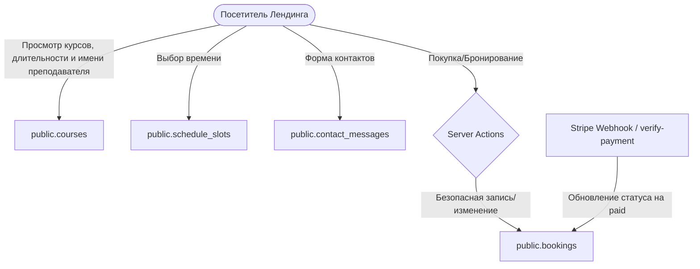

# Схема Базы Данных для Лендинга (Atena School Landing DB Schema)

Данный документ описывает структуру таблиц базы данных Supabase, используемых на публичном лендинге (Atena School Landing), их назначение, взаимосвязи и уровни доступа (RLS). Предназначен для разработчиков и ИИ-агентов.

---

## 1. Таблицы Витрины (Публичные данные)

### `courses` (Курсы и Услуги)
* **Назначение**: Хранит список доступных курсов, занятий и товаров магазина.
* **Поля**:
  * `id` (UUID, PK) — Уникальный идентификатор.
  * `name` / `title_it` (Text) — Название курса.
  * `description` / `description_it` (Text) — Описание курса.
  * `price` / `price_eur` (Numeric/Text) — Стоимость.
  * `photo_url` / `image_url` (Text) — Ссылка на обложку курса/товара.
  * `duration` (Text) — Продолжительность курса (видима для всех).
  * `teacher_name` (Text) — Имя преподавателя курса (видимо для всех напрямую из этой таблицы).
* **RLS / Безопасность**:
  * `SELECT`: Открыт для всех (`public`), чтобы любой посетитель видел каталог, включая стоимость, описание, длительность (`duration`), имя учителя (`teacher_name`) и обложку курса.
  * `INSERT/UPDATE/DELETE`: Разрешено только для `admin`.

### `teachers` (Преподаватели)
* **Назначение**: Хранит полные профили учителей.
* **Связи**: Один учитель может вести несколько курсов.
* **RLS / Безопасность**:
  * `SELECT`: Открыт для авторизованных пользователей (`authenticated`). 
  * *Примечание:* На самом лендинге имя преподавателя (`teacher_name`) и фото курса считываются анонимными пользователями напрямую из публичной таблицы `courses`, что исключает необходимость прямого публичного доступа к закрытой таблице `teachers`.
  * `INSERT/UPDATE/DELETE`: Разрешено только для `admin`.

### `course_teachers` (Связующая таблица)
* **Назначение**: Реализует связь "многие-ко-многим" между `courses` и `teachers` для внутренних систем.
* **Поля**:
  * `course_id` (UUID, FK -> `courses.id`)
  * `teacher_id` (UUID, FK -> `teachers.id`)
* **RLS / Безопасность**:
  * `SELECT`: Доступен для `authenticated`.
  * `INSERT/UPDATE/DELETE`: Разрешено только для `admin`.

### `schedule_slots` (Свободные слоты времени)
* **Назначение**: Список дат и временных интервалов, доступных для бронирования уроков.
* **Поля**:
  * `id` (UUID, PK)
  * `starts_at` (Timestamp) — Время начала занятия.
  * `ends_at` (Timestamp) — Время окончания занятия.
* **RLS / Безопасность**:
  * `SELECT`: Открыт для всех (`public`), чтобы гости могли выбрать время при оформлении заказа.
  * `INSERT/UPDATE/DELETE`: Разрешено только для `admin`.

---

## 2. Таблицы Внутренней Логики (Служебная запись)

### `bookings` (Бронирования и Корзина)
* **Назначение**: Хранит заказы пользователей, товары в корзине и статус бронирования уроков.
* **Поля**:
  * `id` (UUID, PK)
  * `item_id` (UUID, FK -> `courses.id` или `shop_items.id`) — Идентификатор курса/товара.
  * `item_type` (Text) — Тип товара (`course` или `shop`).
  * `user_id` (UUID, Nullable, FK -> `auth.users`) — Идентификатор зарегистрированного пользователя.
  * `session_id` (Text, Nullable) — Временный ID сессии для неавторизованных гостей.
  * `student_name` (Text) — Имя студента.
  * `student_email` (Text) — Email студента.
  * `student_phone` (Text) — Телефон студента.
  * `booking_date` (Date) / `booking_time` (Time) — Выбранное время.
  * `status` (Text) — Текущий статус брони (`in_cart`, `pending_payment`, `reserved`, `paid`, `completed`).
* **RLS / Безопасность**:
  * **Правило 1 (SELECT)**: Пользователь или гость может читать только свои записи. Это проверяется по совпадению `user_id = auth.uid()` или `student_email = auth.jwt.email` (для вошедших) или по заголовку `x-session-id`, передаваемому клиентом (для гостей).
  * **Правило 2 (INSERT)**: Любой гость может создать запись (`public`), но статус при создании жестко ограничен списком: `('in_cart', 'pending_payment', 'reserved')`. Никто не может вручную вставить запись со статусом `"paid"`.
  * **Правило 3 (UPDATE / DELETE)**: Прямые изменения (смена статусов) и удаления из фронтенда для гостей запрещены — все операции проходят через безопасные Server Actions на сервере. Исключение сделано для авторизованных пользователей при слиянии корзины после входа (разрешено связать свои гостевые записи со своим `user_id` по совпадению `student_email` или по совпадению `x-session-id` сессии браузера).

### `contact_messages` (Сообщения с формы контактов)
* **Назначение**: Сбор заявок и обращений из формы обратной связи.
* **RLS / Безопасность**:
  * `INSERT`: Разрешено публично для всех (`public`), чтобы любой желающий мог отправить сообщение.
  * `SELECT/UPDATE/DELETE`: Разрешено только для `admin`. Никто посторонний не может прочесть чужие отправленные сообщения.

---

## 3. Схема Взаимодействия (Data Flow)

---

## 4. Другие таблицы (CRM/LMS) — Закрытая внутренняя часть

Эти таблицы **не используются на лендинге** и полностью закрыты от публичного доступа. Доступ к ним строго ограничен по ролям и идентификаторам владельцев:

* **`public.users` (Профили пользователей)**: 
  * `SELECT`: Разрешен только владельцу профиля (`id = auth.uid()`) либо ролям `admin` и `teacher`. Другие пользователи получить доступ не могут.
  * `UPDATE`: Разрешен только самому пользователю или админу.
  * `DELETE`: Разрешен только `admin`.
* **`public.students` (Студенты)**:
  * `SELECT`: Доступен только самому студенту (`student_id = auth.uid()`) либо ролям `admin` и `teacher`.
  * `INSERT/DELETE`: Только `admin`.
  * `UPDATE`: Только сам студент или `admin`.
* **`public.student_courses` (Записи на курсы)**:
  * `SELECT`: Студент видит только свои записи (`student_id = auth.uid()`), админы и учителя видят все.
  * `INSERT/DELETE`: Только `admin`.
* **`public.grades` (Оценки)**, **`public.attendance` (Посещаемость)**:
  * `SELECT`: Доступна только самому студенту (`student_id = auth.uid()`), админам и учителям.
  * `INSERT/UPDATE/DELETE`: Разрешено только ролям `admin` и `teacher`.
* **`public.payments` (Платежи)**:
  * `SELECT`: Доступен только владельцу (`student_id = auth.uid()`) или админу.
  * `INSERT/UPDATE/DELETE`: Разрешено только `admin`.
* **`public.documents` (Документы)**:
  * `SELECT`: Доступен только студенту с совпадающим email (`student_email`), админам и учителям.
  * `INSERT/UPDATE/DELETE`: Только `admin`.
* **`public.activity_logs` (Логи системы)**:
  * `SELECT`: Только `admin`.
  * `INSERT`: Любой авторизованный пользователь (при совершении действий).
  * `UPDATE/DELETE`: **Запрещено абсолютно всем** (даже админам), что гарантирует неизменяемость логов аудита.

