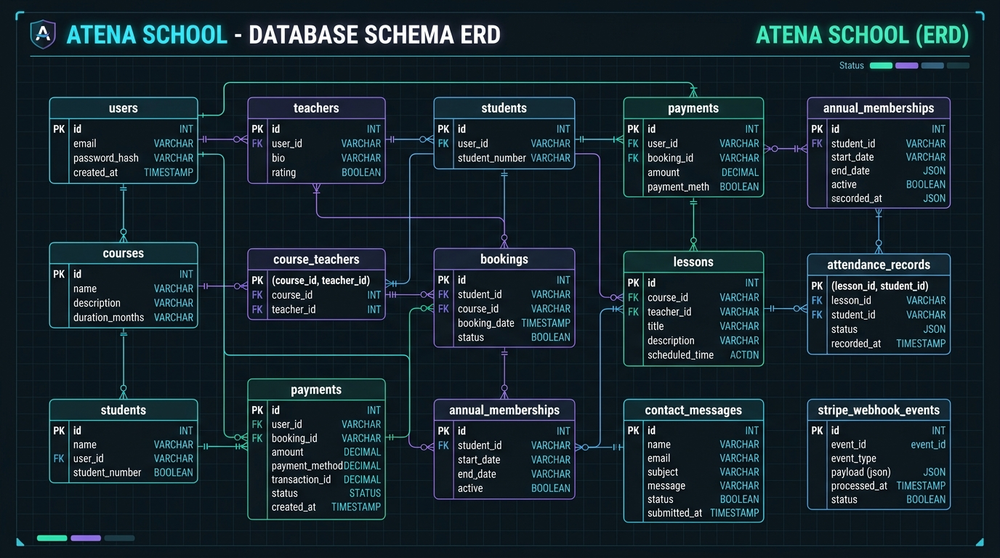

# Atena School — Database Entity Relationship Diagram (ERD)

---

## 1. Mermaid Entity-Relationship Diagram

```mermaid
erDiagram
    users ||--o| teachers : "has profile (PK/FK)"
    users ||--o{ students : "parent of (parent_id)"
    users ||--o| students : "student account (student_user_id)"
    users ||--o{ bookings : "purchased by (purchaser_id/email)"
    
    courses ||--o{ course_teachers : "taught by"
    teachers ||--o{ course_teachers : "assigned to"
    
    courses ||--o{ bookings : "booked in"
    students ||--o{ bookings : "enrolled in"
    
    bookings ||--o{ payments : "paid via (1:N)"
    bookings ||--o{ lessons : "generates (1:N)"
    courses ||--o{ lessons : "course template"
    teachers ||--o{ lessons : "instructs"
    
    lessons ||--o{ attendance_records : "attendance journal (1:N)"
    students ||--o{ attendance_records : "student presence"
    bookings ||--o{ attendance_records : "booking reference"
    
    students ||--o{ annual_memberships : "membership year (Quota €30)"
    bookings ||--o{ annual_memberships : "purchased in booking"

    users {
        uuid id PK "gen_random_uuid()"
        timestamptz created_at "NOT NULL DEFAULT now()"
        timestamptz updated_at "NOT NULL DEFAULT now()"
        text email UK "NOT NULL, UNIQUE"
        text full_name "NOT NULL"
        smallint role "1=STUDENT, 2=TEACHER, 3=ADMIN, 4=PARENT, 5=SECRETARY, 6=SUPERADMIN"
        boolean is_active "NOT NULL DEFAULT true"
        text phone "nullable"
        text tax_code "Codice Fiscale (nullable)"
        text sdi_code "Codice SDI per Fattura (nullable)"
        text pec_email "Posta Elettronica Certificata (nullable)"
        text avatar_url "nullable"
        text notes "nullable"
    }

    teachers {
        uuid teacher_id PK,FK "refs users.id ON DELETE CASCADE"
        timestamptz created_at "NOT NULL DEFAULT now()"
        timestamptz updated_at "NOT NULL DEFAULT now()"
        text full_name "NOT NULL"
        boolean is_active "NOT NULL DEFAULT true"
        text experience "Bio / Qualifiche"
        text photo_url "nullable"
        bigint color_value "Calendar HEX/ARGB color"
        date hire_date "CURRENT_TIMESTAMP"
        date birth_date "nullable"
        uuid contract_id "nullable"
    }

    students {
        uuid id PK "gen_random_uuid()"
        timestamptz created_at "NOT NULL DEFAULT now()"
        timestamptz updated_at "NOT NULL DEFAULT now()"
        text first_name "NOT NULL"
        text last_name "NOT NULL"
        text full_name "GENERATED ALWAYS / Synced"
        text email "nullable"
        text phone "nullable"
        text tax_code "Codice Fiscale dello Studente"
        date birth_date "Data di Nascita"
        text photo_url "nullable"
        smallint language_level "1=A1, 2=A2, 3=B1, 4=B2, 5=C1, 6=C2, 7=UNKNOWN"
        smallint status "1=LEAD, 2=ACTIVE, 3=PAUSED, 4=ARCHIVED"
        boolean annual_fee_paid "true if Quota €30 paid this year"
        timestamptz annual_fee_paid_at "Data pagamento quota"
        timestamptz registration_date "Data prima registrazione"
        uuid parent_id FK "refs users.id (ON DELETE SET NULL)"
        uuid student_user_id FK "refs users.id (ON DELETE SET NULL)"
        uuid contract_id "nullable"
    }

    courses {
        uuid id PK "gen_random_uuid()"
        timestamptz created_at "NOT NULL DEFAULT now()"
        timestamptz updated_at "NOT NULL DEFAULT now()"
        text name "Codename / English Title"
        text title_it "Titolo Italiano per Landing"
        text category "Lingue, Informatica, Doposcuola, Certificazioni"
        text description "Descrizione completa"
        decimal price "NOT NULL, DECIMAL(10,2)"
        smallint billing_type "1=FULL_UPFRONT, 2=MONTHLY_SUBSCRIPTION, 3=INSTALLMENTS"
        smallint status "1=ACTIVE, 2=DRAFT, 3=ARCHIVED"
        smallint format "1=INDIVIDUAL, 2=GROUP, 3=INTENSIVE, 4=CUSTOM"
        smallint schedule_type "1=FIXED, 2=FLEXIBLE, 3=RECURRING, 4=INTENSIVE"
        integer lesson_duration_minutes "Default 60 min"
        smallint total_lessons "Default 10 / 20 / 30"
        jsonb schedule_days "Array di giorni ISO [1, 3] (Lun/Mer)"
        time start_time "Orario inizio lezione (09:00)"
        time end_time "Orario fine lezione (10:00)"
        date start_date "Data inizio ciclo corso"
        date end_date "Data fine stimata ciclo"
        integer max_students "Capienza massima per classi di gruppo"
        integer current_enrolled "Contatore iscritti attivi"
        text image_url "Locandina corso"
    }

    course_teachers {
        uuid course_id PK,FK "refs courses.id ON DELETE CASCADE"
        uuid teacher_id PK,FK "refs teachers.teacher_id ON DELETE CASCADE"
        timestamptz created_at "NOT NULL DEFAULT now()"
        boolean is_primary "Docente titolare del corso"
    }

    bookings {
        uuid id PK "gen_random_uuid()"
        timestamptz created_at "NOT NULL DEFAULT now()"
        timestamptz updated_at "NOT NULL DEFAULT now()"
        uuid course_id FK "refs courses.id ON DELETE RESTRICT"
        uuid student_id FK "refs students.id ON DELETE SET NULL"
        text purchaser_name "Nome e Cognome acquirente"
        text purchaser_email "Email acquirente"
        text purchaser_phone "Telefono acquirente"
        text purchaser_tax_code "Codice Fiscale acquirente (Fattura)"
        text student_name "Nome e Cognome studente effettivo"
        text student_email "Email studente"
        text student_phone "Telefono studente"
        text student_tax_code "Codice Fiscale studente"
        boolean is_for_child "true se il genitore acquista per il figlio"
        decimal total_amount "NOT NULL, DECIMAL(10,2)"
        decimal amount_paid "Somma totale incassata, DECIMAL(10,2)"
        smallint payment_status "1=RESERVED, 2=PAID, 3=PARTIAL, 4=FAILED, 5=REFUNDED"
        smallint status "1=ACTIVE, 2=CONFIRMED, 3=CANCELLED, 4=COMPLETED"
        smallint scheduling_status "1=PENDING, 2=SCHEDULED, 3=IN_PROGRESS, 4=COMPLETED"
        smallint payment_method "1=STRIPE, 2=CASH, 3=BANK_TRANSFER, 4=POS"
        smallint billing_scheme "1=FULL, 2=INSTALLMENTS, 3=SUBSCRIPTION"
        text stripe_session_id "Stripe Checkout Session ID"
        text stripe_payment_intent_id "Stripe PI ID"
        text stripe_customer_id "Stripe Customer ID"
        text course_name "Snapshot nome corso"
        decimal course_price "Snapshot prezzo corso"
        integer total_lessons "Snapshot numero lezioni previste"
        text notes "Note amministrative"
    }

    payments {
        uuid id PK "gen_random_uuid()"
        timestamptz created_at "NOT NULL DEFAULT now()"
        timestamptz updated_at "NOT NULL DEFAULT now()"
        uuid booking_id FK "refs bookings.id ON DELETE RESTRICT"
        decimal amount "NOT NULL, DECIMAL(10,2)"
        smallint currency "1=EUR, 2=USD, 3=GBP"
        smallint method "1=STRIPE, 2=CASH, 3=BANK_TRANSFER, 4=POS"
        smallint type "1=PAYMENT (Corso), 2=REGISTRATION_FEE (Quota €30), 3=REFUND"
        smallint status "1=SUCCEEDED, 2=PENDING, 3=FAILED, 4=REFUNDED"
        smallint provider "1=STRIPE, 2=MANUAL"
        text stripe_payment_intent_id "Stripe PI ID"
        text stripe_charge_id "Stripe Ch ID"
        text receipt_url "Link ricevuta / Fattura Stripe"
        text notes "Note di pagamento"
    }

    annual_memberships {
        uuid id PK "gen_random_uuid()"
        timestamptz created_at "NOT NULL DEFAULT now()"
        timestamptz updated_at "NOT NULL DEFAULT now()"
        uuid student_id FK "refs students.id ON DELETE CASCADE"
        uuid booking_id FK "refs bookings.id ON DELETE SET NULL"
        integer year "Anno associativo (es. 2026)"
        decimal fee_amount "30.00 EUR"
        smallint status "1=ACTIVE, 2=EXPIRED, 3=CANCELLED"
        date start_date "Data inizio validità"
        date end_date "31 Dicembre dell'anno in corso"
        text notes "Note associazione"
    }

    lessons {
        uuid id PK "gen_random_uuid()"
        timestamptz created_at "NOT NULL DEFAULT now()"
        timestamptz updated_at "NOT NULL DEFAULT now()"
        uuid booking_id FK "refs bookings.id ON DELETE CASCADE"
        uuid course_id FK "refs courses.id ON DELETE SET NULL"
        uuid student_id FK "refs students.id ON DELETE SET NULL"
        uuid teacher_id FK "refs teachers.teacher_id ON DELETE SET NULL"
        timestamptz starts_at "Data e ora inizio lezione"
        timestamptz ends_at "Data e ora fine lezione"
        smallint status "1=SCHEDULED, 2=COMPLETED, 3=CANCELLED, 4=RESCHEDULED, 5=NO_SHOW"
        smallint attendance "1=PENDING, 2=PRESENT, 3=ABSENT, 4=LATE, 5=EXCUSED"
        smallint location_type "1=IN_PERSON, 2=ONLINE, 3=HYBRID"
        text meeting_link "Link Google Meet / Zoom per lezioni online"
        text homework "Compiti assegnati"
        text teacher_notes "Note private del docente"
        integer reschedule_count "Contatore riprogrammazioni"
        timestamptz rescheduled_at "Data ultima riprogrammazione"
    }

    attendance_records {
        uuid id PK "gen_random_uuid()"
        timestamptz created_at "NOT NULL DEFAULT now()"
        timestamptz updated_at "NOT NULL DEFAULT now()"
        uuid lesson_id FK "refs lessons.id ON DELETE CASCADE"
        uuid student_id FK "refs students.id ON DELETE SET NULL"
        uuid booking_id FK "refs bookings.id ON DELETE SET NULL"
        smallint status "1=PENDING, 2=PRESENT, 3=ABSENT, 4=LATE, 5=EXCUSED"
        text marked_by "ID o Nome dell'utente/docente che ha registrato la presenza"
        timestamptz marked_at "Timestamp marcatura presenza"
        text notes "Note presenza (es. 'Uscito 15 minuti prima')"
    }

    contact_messages {
        uuid id PK "gen_random_uuid()"
        timestamptz created_at "NOT NULL DEFAULT now()"
        timestamptz updated_at "NOT NULL DEFAULT now()"
        text first_name "Nome del contatto"
        text last_name "Cognome del contatto"
        text email "Email"
        text phone "Telefono"
        text interest "Corso o argomento di interesse"
        text message "Messaggio inviato dal form"
        smallint status "1=NEW, 2=IN_PROGRESS, 3=RESOLVED, 4=ARCHIVED"
        text notes "Note del team di segreteria"
    }

    stripe_webhook_events {
        uuid id PK "gen_random_uuid()"
        timestamptz created_at "NOT NULL DEFAULT now()"
        text event_id UK "Stripe Event ID (evt_xxx) UNIQUE"
        text event_type "checkout.session.completed, payment_intent.succeeded..."
        jsonb payload "Corpo JSON completo dell'evento Stripe"
        boolean processed "true se gestito con successo"
        timestamptz processed_at "Data e ora elaborazione"
        text error "Eventuale messaggio di errore di elaborazione"
    }

    app_settings {
        text key PK "Parametro di configurazione (es. stripe_live_mode)"
        jsonb value "Valore dinamico JSONB"
        text description "Descrizione del parametro"
        timestamptz updated_at "NOT NULL DEFAULT now()"
    }
```

---

## 2. Ключевые архитектурные взаимосвязи

| Связка сущностей | Кардинальность | Поведение при каскадном удалении | Назначение в бизнес-процессах |
| :--- | :---: | :---: | :--- |
| `users` $\rightarrow$ `teachers` | $1:0..1$ | `ON DELETE CASCADE` | 1-к-1 расширение базового аккаунта профилем преподавателя. |
| `users` $\rightarrow$ `students` (Parent) | $1:N$ | `ON DELETE SET NULL` | Семейные аккаунты: один родитель может иметь несколько детей-студентов. |
| `users` $\rightarrow$ `students` (Direct) | $1:0..1$ | `ON DELETE SET NULL` | Аккаунт взрослого студента, авторизующегося самостоятельно. |
| `courses` $\leftrightarrow$ `teachers` | $M:N$ via `course_teachers` | `ON DELETE CASCADE` | Курсы могут вести несколько преподавателей с выделением основного (`is_primary`). |
| `bookings` $\rightarrow$ `payments` | $1:N$ | `ON DELETE RESTRICT` | Двойной платёж на заказ (курс + взнос €30) и поддержка рассрочки. |
| `students` $\rightarrow$ `annual_memberships` | $1:N$ | `ON DELETE CASCADE` | Ежегодная фиксация уплаты взноса ассоциации (€30). |
| `lessons` $\rightarrow$ `attendance_records` | $1:N$ | `ON DELETE CASCADE` | Индивидуальный журнал присутствия каждого студента на каждом занятии. |
