# Atena School — Database Entity Relationship Diagram (ERD)

---

## 1. Mermaid Entity-Relationship Diagram

```mermaid
erDiagram
    users ||--o| teachers : "has profile (PK/FK)"
    users ||--o{ students : "parent of (parent_id)"
    users ||--o| students : "student account (student_user_id)"
    users ||--o{ bookings : "purchased by (user_id)"
    users ||--o{ payments : "ledger owner (user_id)"
    users ||--o{ landing_api_logs : "audit trace (user_id)"
    users ||--o{ app_api_logs : "audit trace (user_id)"
    users ||--o{ admin_api_logs : "audit trace (user_id)"
    
    courses ||--o{ course_teachers : "taught by"
    teachers ||--o{ course_teachers : "assigned to"
    
    courses ||--o{ groups : "has cohorts"
    teachers ||--o{ groups : "leads group"
    groups ||--o{ group_members : "enrolled students (1:N)"
    students ||--o{ group_members : "member of"
    bookings ||--o{ group_members : "booking link"
    
    courses ||--o{ bookings : "booked in"
    students ||--o{ bookings : "enrolled in"
    groups ||--o{ bookings : "assigned group"
    
    bookings ||--o{ payments : "paid via (1:N)"
    bookings ||--o{ lessons : "individual lessons"
    groups ||--o{ lessons : "group lessons"
    courses ||--o{ lessons : "course template"
    teachers ||--o{ lessons : "instructs"
    
    lessons ||--o{ attendance_records : "attendance journal (1:N)"
    students ||--o{ attendance_records : "student presence"
    bookings ||--o{ attendance_records : "booking reference"
    
    students ||--o{ annual_memberships : "membership year (Quota €30)"
    bookings ||--o{ annual_memberships : "purchased in booking"

    users {
        uuid id PK "gen_random_uuid()"
        timestamptz created_at "NOT NULL DEFAULT now()"
        timestamptz updated_at "NOT NULL DEFAULT now()"
        text email UK "NOT NULL, UNIQUE"
        text full_name "NOT NULL"
        smallint role "1=STUDENT, 2=TEACHER, 3=ADMIN, 4=PARENT, 5=SECRETARY, 6=SUPERADMIN"
        boolean is_active "NOT NULL DEFAULT true"
        text phone "nullable"
        text tax_code "Codice Fiscale (nullable)"
        text sdi_code "Codice SDI per Fattura (nullable)"
        text pec_email "Posta Elettronica Certificata (nullable)"
        text avatar_url "nullable"
        text notes "nullable"
    }

    teachers {
        uuid teacher_id PK,FK "refs users.id ON DELETE CASCADE"
        timestamptz created_at "NOT NULL DEFAULT now()"
        timestamptz updated_at "NOT NULL DEFAULT now()"
        text full_name "NOT NULL"
        boolean is_active "NOT NULL DEFAULT true"
        text experience "Bio / Qualifiche"
        text photo_url "nullable"
        bigint color_value "Calendar HEX/ARGB color"
        date hire_date "CURRENT_TIMESTAMP"
        date birth_date "nullable"
        uuid contract_id "nullable"
    }

    students {
        uuid id PK "gen_random_uuid()"
        timestamptz created_at "NOT NULL DEFAULT now()"
        timestamptz updated_at "NOT NULL DEFAULT now()"
        text first_name "NOT NULL"
        text last_name "NOT NULL"
        text full_name "GENERATED ALWAYS / Synced"
        text email "nullable"
        text phone "nullable"
        text tax_code "Codice Fiscale dello Studente"
        date birth_date "Data di Nascita"
        text photo_url "nullable"
        smallint language_level "1=A1, 2=A2, 3=B1, 4=B2, 5=C1, 6=C2, 7=UNKNOWN"
        smallint status "1=LEAD, 2=ACTIVE, 3=PAUSED, 4=ARCHIVED"
        boolean annual_fee_paid "true if Quota €30 paid this year"
        timestamptz annual_fee_paid_at "Data pagamento quota"
        date registration_date "Data prima registrazione"
        uuid parent_id FK "refs users.id (ON DELETE SET NULL)"
        uuid student_user_id FK "refs users.id (ON DELETE SET NULL)"
        uuid contract_id "nullable"
    }

    courses {
        uuid id PK "gen_random_uuid()"
        timestamptz created_at "NOT NULL DEFAULT now()"
        timestamptz updated_at "NOT NULL DEFAULT now()"
        text name "Codename / English Title"
        text slug UK "Unique slug for SEO / URLs"
        smallint category "1=LANGUAGES, 2=CERTIPASS, 3=TUTORING, 4=KIDS"
        smallint status "1=ACTIVE, 2=DRAFT, 3=ARCHIVED"
        integer sort_order "Default 0"
        text photo_url "Locandina corso"
        text description "Descrizione completa"
        uuid teacher_id FK "refs teachers.teacher_id"
        smallint course_format "1=INDIVIDUAL, 2=GROUP, 3=INTENSIVE, 4=CUSTOM"
        smallint schedule_type "1=FIXED, 2=FLEXIBLE, 3=RECURRING, 4=INTENSIVE"
        integer[] schedule_days "Array di giorni ISO [1, 3] (Lun/Mer)"
        text start_time "Orario inizio lezione (18:00)"
        text end_time "Orario fine lezione (19:30)"
        integer lesson_duration_minutes "Default 60 min"
        integer lessons_per_week "Numero lezioni settimanali"
        integer total_lessons "Default 8 / 16 / 24"
        integer total_hours "Ore totali"
        smallint billing_type "1=FULL_UPFRONT, 2=SUBSCRIPTION_ONLY, 3=BOTH"
        decimal price "NOT NULL, DECIMAL(10,2)"
        decimal subscription_price "Prezzo mensile in abbonamento"
        text stripe_monthly_price_id "Stripe Price ID per abbonamento"
    }

    course_teachers {
        uuid course_id PK,FK "refs courses.id ON DELETE CASCADE"
        uuid teacher_id PK,FK "refs teachers.teacher_id ON DELETE CASCADE"
        smallint role "1=PRIMARY, 2=ASSISTANT"
        boolean is_primary "Docente titolare del corso"
        timestamptz created_at "NOT NULL DEFAULT now()"
    }

    groups {
        uuid id PK "gen_random_uuid()"
        timestamptz created_at "NOT NULL DEFAULT now()"
        timestamptz updated_at "NOT NULL DEFAULT now()"
        text name "Nome Gruppo / Classe"
        uuid course_id FK "refs courses.id ON DELETE CASCADE"
        uuid teacher_id FK "refs teachers.teacher_id ON DELETE SET NULL"
        text room "Aula / Sede (es. Aula 1 / Zoom)"
        integer max_students "Capienza massima (default 8)"
        smallint status "1=RECRUITING, 2=IN_PROGRESS, 3=COMPLETED, 4=ARCHIVED"
        date start_date "Data inizio ciclo corso"
        date end_date "Data fine stimata ciclo"
        integer[] schedule_days "Array di giorni ISO [2, 4] (Mar/Gio)"
        text start_time "Orario inizio (18:00)"
        text end_time "Orario fine (19:30)"
        text notes "Note didattiche"
    }

    group_members {
        uuid id PK "gen_random_uuid()"
        timestamptz created_at "NOT NULL DEFAULT now()"
        timestamptz updated_at "NOT NULL DEFAULT now()"
        uuid group_id FK "refs groups.id ON DELETE CASCADE"
        uuid student_id FK "refs students.id ON DELETE CASCADE"
        uuid booking_id FK "refs bookings.id ON DELETE SET NULL"
        timestamptz joined_at "Data inserimento nella classe"
        smallint status "1=ACTIVE, 2=PAUSED, 3=COMPLETED, 4=DROPPED"
    }

    bookings {
        uuid id PK "gen_random_uuid()"
        timestamptz created_at "NOT NULL DEFAULT now()"
        timestamptz updated_at "NOT NULL DEFAULT now()"
        text session_id "Sessione / Idempotency Key"
        uuid user_id FK "refs users.id ON DELETE SET NULL"
        uuid student_id FK "refs students.id ON DELETE SET NULL"
        uuid course_id FK "refs courses.id ON DELETE RESTRICT"
        uuid group_id FK "refs groups.id ON DELETE SET NULL"
        text course_name "Snapshot nome corso"
        text student_name "Nome e Cognome studente"
        text student_email "Email studente"
        text student_phone "Telefono studente"
        text student_tax_code "Codice Fiscale studente"
        date student_birth_date "Data di Nascita studente"
        text purchaser_name "Nome acquirente (Fattura)"
        text purchaser_email "Email acquirente"
        text purchaser_phone "Telefono acquirente"
        text purchaser_tax_code "Codice Fiscale acquirente"
        text sdi_code "Codice SDI per Fattura Elettronica"
        text pec_email "PEC per Fattura"
        smallint booking_status "1=ACTIVE, 2=COMPLETED, 3=CANCELLED"
        smallint payment_status "1=PENDING, 2=RESERVED, 3=PAID, 4=REFUNDED, 5=PARTIALLY_REFUNDED, 6=FAILED, 7=CANCELLED"
        smallint scheduling_status "1=SCHEDULED, 2=PENDING_COORDINATION"
        smallint billing_scheme "1=FULL, 2=INSTALLMENTS, 3=PER_LESSON, 4=SUBSCRIPTION"
        smallint payment_method "1=STRIPE, 2=CASH, 3=BANK_TRANSFER, 4=POS"
        decimal amount_paid "Somma totale corso incassata"
        decimal registration_fee "Quota associativa €30"
        decimal discount_amount "Sconto applicato"
        text promo_code "Codice promozionale"
        date start_date "Data inizio ciclo"
        integer[] schedule_days "Giorni di frequenza [1, 3]"
        text start_time "Orario inizio"
        text end_time "Orario fine"
        integer total_lessons_count "Numero lezioni previste"
        text notes "Note amministrative"
        text stripe_customer_id "Stripe Customer ID"
        text stripe_subscription_id "Stripe Subscription ID"
        smallint subscription_status "1=ACTIVE, 2=PENDING, 3=PAST_DUE, 4=PAUSED, 5=CANCELED"
        timestamptz subscription_starts_at "Data inizio abbonamento"
        timestamptz subscription_ends_at "Data fine ciclo mensile"
        boolean cancel_at_period_end "true se disdetto a fine mese"
    }

    payments {
        uuid id PK "gen_random_uuid()"
        timestamptz created_at "NOT NULL DEFAULT now()"
        timestamptz paid_at "Data e ora accredito"
        timestamptz updated_at "NOT NULL DEFAULT now()"
        uuid booking_id FK "refs bookings.id ON DELETE SET NULL"
        uuid student_id FK "refs students.id ON DELETE SET NULL"
        uuid user_id FK "refs users.id ON DELETE SET NULL"
        decimal amount "NOT NULL, DECIMAL(10,2)"
        smallint currency "1=EUR, 2=USD, 3=GBP"
        smallint type "1=COURSE_PAYMENT, 2=REGISTRATION_FEE (€30), 3=REFUND"
        smallint status "1=SUCCEEDED, 2=PENDING, 3=FAILED, 4=REFUNDED"
        smallint payment_method "1=STRIPE, 2=CASH, 3=BANK_TRANSFER, 4=POS"
        smallint provider "1=STRIPE, 2=MANUAL"
        text provider_transaction_id "Stripe PI ID / Transazione POS"
        text notes "Note contabili"
    }

    annual_memberships {
        uuid id PK "gen_random_uuid()"
        timestamptz created_at "NOT NULL DEFAULT now()"
        text tax_code "Codice Fiscale socio"
        uuid student_id FK "refs students.id ON DELETE SET NULL"
        uuid user_id FK "refs users.id ON DELETE SET NULL"
        text membership_number "Numero tessera (es. ATN-2026-0001)"
        decimal amount "Quota associativa €30.00"
        smallint payment_method "1=STRIPE, 2=CASH, 3=BANK_TRANSFER, 4=POS"
        uuid payment_id FK "refs payments.id ON DELETE SET NULL"
        smallint status "1=ACTIVE, 2=EXPIRED, 3=CANCELLED"
        text academic_year "Anno accademico (es. 2026/2027)"
        timestamptz paid_at "Data pagamento"
        timestamptz expires_at "Scadenza (31 Agosto)"
    }

    lessons {
        uuid id PK "gen_random_uuid()"
        timestamptz created_at "NOT NULL DEFAULT now()"
        timestamptz updated_at "NOT NULL DEFAULT now()"
        uuid booking_id FK "refs bookings.id ON DELETE CASCADE (nullable per gruppi)"
        uuid group_id FK "refs groups.id ON DELETE CASCADE (per classi collettive)"
        uuid course_id FK "refs courses.id ON DELETE SET NULL"
        uuid student_id FK "refs students.id ON DELETE SET NULL"
        uuid teacher_id FK "refs teachers.teacher_id ON DELETE SET NULL"
        timestamptz starts_at "Data e ora inizio lezione"
        timestamptz ends_at "Data e ora fine lezione"
        smallint status "1=SCHEDULED, 2=COMPLETED, 3=CANCELLED, 4=RESCHEDULED"
        smallint attendance "1=PENDING, 2=PRESENT, 3=ABSENT, 4=LATE, 5=EXCUSED"
        smallint location_type "1=IN_PERSON, 2=ONLINE, 3=HYBRID"
        text meeting_link "Link Google Meet / Zoom"
        text homework "Compiti assegnati"
        text teacher_notes "Note private del docente"
        integer reschedule_count "Contatore riprogrammazioni"
        timestamptz rescheduled_at "Data ultima modifica orario"
    }

    attendance_records {
        uuid id PK "gen_random_uuid()"
        timestamptz created_at "NOT NULL DEFAULT now()"
        timestamptz updated_at "NOT NULL DEFAULT now()"
        timestamptz marked_at "Timestamp marcatura presenza"
        uuid lesson_id FK "refs lessons.id ON DELETE CASCADE"
        uuid booking_id FK "refs bookings.id ON DELETE SET NULL"
        uuid student_id FK "refs students.id ON DELETE SET NULL"
        smallint status "1=PENDING, 2=PRESENT, 3=ABSENT, 4=LATE, 5=EXCUSED"
        text marked_by "ID o Nome utente che ha registrato"
        text notes "Note presenza"
    }

    landing_api_logs {
        uuid id PK "gen_random_uuid()"
        timestamptz created_at "NOT NULL DEFAULT now()"
        varchar controller "Controller name"
        varchar action "Method name"
        varchar http_method "GET/POST/PUT/DELETE"
        varchar endpoint "URL path"
        uuid user_id FK "refs users.id ON DELETE SET NULL"
        smallint user_role "1=STUDENT, 2=TEACHER, 3=ADMIN, 4=PARENT"
        varchar ip_address "IP client"
        text user_agent "Browser user-agent"
        jsonb request "Payload & Session ID"
        jsonb response "Risposta API"
        integer status_code "HTTP Status Code (200, 400, 500)"
    }

    app_api_logs {
        uuid id PK "gen_random_uuid()"
        timestamptz created_at "NOT NULL DEFAULT now()"
        varchar controller "Controller name"
        varchar action "Method name"
        varchar http_method "GET/POST/PUT/DELETE"
        varchar endpoint "URL path"
        uuid user_id FK "refs users.id ON DELETE SET NULL"
        smallint user_role "1=STUDENT, 2=TEACHER, 3=ADMIN, 4=PARENT"
        varchar ip_address "IP client"
        text user_agent "Browser user-agent"
        jsonb request "Payload & Session ID"
        jsonb response "Risposta API"
        integer status_code "HTTP Status Code"
    }

    admin_api_logs {
        uuid id PK "gen_random_uuid()"
        timestamptz created_at "NOT NULL DEFAULT now()"
        varchar controller "Controller name"
        varchar action "Method name"
        varchar http_method "GET/POST/PUT/DELETE"
        varchar endpoint "URL path"
        uuid user_id FK "refs users.id ON DELETE SET NULL"
        smallint user_role "1=STUDENT, 2=TEACHER, 3=ADMIN, 4=PARENT"
        varchar ip_address "IP client"
        text user_agent "Browser user-agent"
        jsonb request "Payload & Session ID"
        jsonb response "Risposta API"
        integer status_code "HTTP Status Code"
    }

    notification_logs {
        uuid id PK "gen_random_uuid()"
        timestamptz created_at "NOT NULL DEFAULT now()"
        smallint channel "1=EMAIL, 2=TELEGRAM"
        smallint notification_type "1=BOOKING_CONFIRMATION, 2=PAYMENT_RECEIPT, 3=MEMBERSHIP_FEE, 4=REMINDER"
        varchar recipient "Email o Telegram chat_id"
        varchar subject "Oggetto notifica"
        jsonb request "Corpo della notifica inviata"
        jsonb response "Risposta provider (Resend/Telegram API)"
        smallint status "1=SENT, 2=FAILED"
    }

    contact_messages {
        uuid id PK "gen_random_uuid()"
        timestamptz created_at "NOT NULL DEFAULT now()"
        timestamptz updated_at "NOT NULL DEFAULT now()"
        text first_name "Nome del contatto"
        text last_name "Cognome del contatto"
        text email "Email"
        text phone "Telefono"
        text interest "Corso o argomento di interesse"
        text message "Messaggio inviato dal form"
        smallint status "1=NEW, 2=IN_PROGRESS, 3=RESOLVED, 4=ARCHIVED"
        text notes "Note del team di segreteria"
    }

    stripe_webhook_events {
        uuid id PK "gen_random_uuid()"
        timestamptz created_at "NOT NULL DEFAULT now()"
        text stripe_event_id UK "Stripe Event ID (evt_xxx) UNIQUE"
        text event_type "checkout.session.completed, invoice.paid..."
        timestamptz processed_at "Data e ora elaborazione"
    }

    app_settings {
        text key PK "Parametro di configurazione (es. stripe_live_mode)"
        jsonb value "Valore dinamico JSONB"
        text description "Descrizione del parametro"
        timestamptz updated_at "NOT NULL DEFAULT now()"
    }
```

---

## 2. Ключевые архитектурные взаимосвязи

| Связка сущностей | Кардинальность | Поведение при каскадном удалении | Назначение в бизнес-процессах |
| :--- | :---: | :---: | :--- |
| `users` $\rightarrow$ `teachers` | $1:0..1$ | `ON DELETE CASCADE` | 1-к-1 расширение базового аккаунта профилем преподавателя. |
| `users` $\rightarrow$ `students` (Parent) | $1:N$ | `ON DELETE SET NULL` | Семейные аккаунты: один родитель может иметь несколько детей-студентов. |
| `users` $\rightarrow$ `students` (Direct) | $1:0..1$ | `ON DELETE SET NULL` | Аккаунт взрослого студента, авторизующегося самостоятельно. |
| `courses` $\rightarrow$ `groups` | $1:N$ | `ON DELETE CASCADE` | Учебные группы/классы, сформированные под конкретный курс. |
| `groups` $\leftrightarrow$ `students` | $M:N$ via `group_members` | `ON DELETE CASCADE` | Реестр зачисленных студентов в группу с уникальным ключом `(group_id, student_id)`. |
| `groups` $\rightarrow$ `lessons` | $1:N$ | `ON DELETE CASCADE` | Единый групповой урок в календаре для всей учебной группы. |
| `bookings` $\rightarrow$ `payments` | $1:N$ | `ON DELETE RESTRICT` | Двойной платёж на заказ (курс + взнос €30) и поддержка рассрочки/подписки. |
| `students` $\rightarrow$ `annual_memberships` | $1:N$ | `ON DELETE CASCADE` | Ежегодная фиксация уплаты взноса ассоциации (€30). |
| `lessons` $\rightarrow$ `attendance_records` | $1:N$ | `ON DELETE CASCADE` | Индивидуальный журнал присутствия каждого студента (как индивидуалов, так и в группах). |
| `users` $\rightarrow$ `*_api_logs` | $1:N$ | `ON DELETE SET NULL` | Сквозной аудит всех действий пользователей на платформе. |
