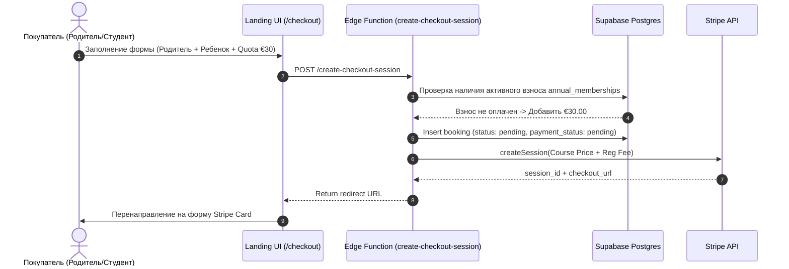

# 🛍️ Документация Лендинга Atena School (`apps/landing`)

## 📌 1. Назначение и Архитектурная Роль
Лендинг (`apps/landing`) является главным витринным и маркетинговым порталом экосистемы Atena School (`atenaschool.com`).

**Главные задачи приложения**:
1. **SEO и Поисковое Продвижение**: Выдача динамических страниц курсов, блога, статей и теста уровня владения языком.
2. **Каталог Курсов**: Фильтрация, подробный просмотр информации о программах, преподавателях и расписании.
3. **Чекаут и Проведение Платежей**: Оплата курсов через Stripe Checkout и офлайн-резервирование мест.
4. **Бессерверная Интеграция**: Вызов Edge Functions Supabase для проведения платежей и обработки Stripe Webhooks.

---

## 📂 2. Структура Проекта (`apps/landing/src`)

```
apps/landing/src/
├── app/                      # Next.js App Router (Роуты и Страницы)
│   ├── page.tsx              # Главная страница (Hero, Курсы, Преимущества, Отзывы)
│   ├── corsi/                # Страницы каталога курсов
│   │   ├── page.tsx          # Каталог с фильтрами по уровню и возрасту
│   │   └── [id]/page.tsx     # Динамическая страница курса (SEO + Schema.org)
│   ├── checkout/             # Формы оплаты и чекаута
│   │   ├── [id]/page.tsx     # Страница оформления заказа (Покупатель + Ученик)
│   │   └── success/page.tsx  # Экран успешной оплаты с выпиской (€109.80 + €30.00)
│   ├── test-inglese/         # Интерактивный тест уровня владения языком
│   ├── blog/                 # Блог и статьи по изучению языков
│   ├── actions/              # Server Actions (booking.ts)
│   └── dashboard/            # Редирект на субдомен ЛК (app.atenaschool.com/dashboard)
├── features/                 # Бизнес-модули интерфейса
│   ├── courses/              # Компоненты курсов, CourseCard, CourseSchema (JSON-LD)
│   ├── checkout/             # Компоненты формы чекаута, введение родителей/детей
│   └── test-inglese/         # Логика вопроса-ответа теста уровня
└── lib/                      # Утилиты и клиенты
    ├── supabase/             # SSR-клиент Supabase (server.ts, client.ts)
    └── utils/                # bookingScheduler (реэкспорт из @repo/api)
```

---

## 🔒 3. Процесс Чекаута и Безопасности (Zero-Trust)



---

## 🔎 4. SEO и Микроразметка Schema.org

* **Динамические Метаданные (`generateMetadata`)**:
  Каждая страница курса `/corsi/[id]` динамически генерирует `title`, `description`, `canonical URL`, `openGraph` (locale `it_IT`) и `twitter:card`.
* **JSON-LD Schema (`CourseSchema`)**:
  Включает стандартную структуру Google Rich Results `schema.org/Course`, передавая точную стоимость, преподавателя и расписание.

---

## 🔗 5. Связь с Другими Компонентами Системы

* **Переход в Личный Кабинет**:
  Все ссылки "Личный Кабинет" и роуты `/dashboard` на лендинге осуществляют HTTP 307 redirect на субдомен `app.atenaschool.com/dashboard`.
* **Ядро Бизнес-Логики**:
  Лендинг использует утилиты `@repo/api` для вычисления даты старта курса и расписания занятий.
