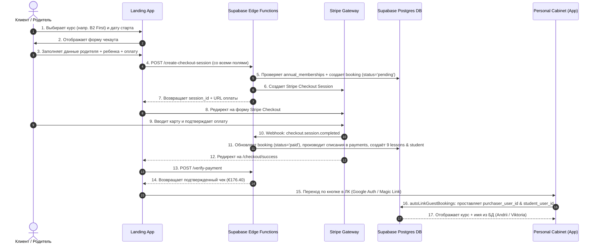

# Use Case: Покупка курса и Онбординг (End-to-End Flow Specification)

> **Документ**: Спецификация бизнес-процесса покупки курса  
> **Проект**: Atena School (`atena_school`)  
> **Целевая аудитория**: Разработчики, Архитекторы БД, QA, Продукт-менеджеры  
> **Последнее обновление**: Июль 2026  

---

## 🎯 1. Обзор Use Case

Этот документ описывает сквозной жизненный цикл покупки учебного курса анонимным клиентом на лендинге (`atenaschool.com`), обработку платежа через Stripe, автоматическое формирование записей в PostgreSQL Supabase и предоставление доступа в Личном Кабинете (`app.atenaschool.com`).

Сценарий поддерживает два варианта оформления:
1. **Покупка родителям для несовершеннолетнего ребенка** (`isForChild = true`):
   - Покупатель — Родитель (финансы, чеки, налоговые данные *Codice Fiscale*).
   - Ученик — Ребенок (прохождение уроков, посещаемость).
2. **Самостоятельная покупка взрослым учеником** (`isForChild = false`):
   - Покупатель и Ученик — одно и то же лицо.

---

## 👥 2. Участники (Actors) & Компоненты

* **Анонимный Гость / Покупатель**: Посетитель сайта, оформляющий заказ.
* **Ученик**: Лицо, проходящее обучение по выбранному курсу.
* **Landing App (`apps/landing`)**: Фронтенд на Next.js для выбора курса и заполнения формы чекаута.
* **Personal Cabinet App (`apps/app`)**: Личный Кабинет студента/родителя для просмотра уроков.
* **Supabase Cloud Edge Functions**:
  * `create-checkout-session`: Инициация заказа и сессии Stripe.
  * `stripe-webhook`: Фоновая асинхронная обработка событий от Stripe.
  * `verify-payment`: Подтверждение платежа при возврате клиента.
* **Stripe Payment Gateway**: Внешний шлюз приема банковских карт.
* **Supabase PostgreSQL Database**: Хранилище данных (`bookings`, `users`, `students`, `annual_memberships`, `lessons`, `payments`).

---

## 📋 3. Пошаговое описание сценария (Step-by-Step Flow)

---

## 🔍 4. Детальные шаги процесса

### Шаг 1: Выбор курса и расписания
* Клиент открывает страницу курса (например, `/corsi/b2-first`).
* Выбирает желаемую дату старта (например, `30 июля 2026`) и время занятий (`Вторник и Четверг 18:00-19:15`).
* Система рассчитывает количество занятий (например, 9 уроков до 27 августа).

### Шаг 2: Заполнение формы чекаута (`/checkout/[id]`)
* Клиент указывает:
  * **Галочка родителя**: `isForChild = true`.
  * **Данные Родителя (Покупателя)**: Имя (`Andrii`), Фамилия (`Petukhov`), Email (`petukhov.1205@gmail.com`), Телефон (`+380665237393`), Codice Fiscale (`SHDFJKGSDHFJHSDGF`).
  * **Данные Ученика (Ребенка)**: Имя (`Viktoria`), Фамилия (`Petukhova`), Email (`petukhov.1337@gmail.com`), Телефон (`+432763564723`), Дата рождения (`10.10.2010`), Codice Fiscale (`PTBNS2345236754723`).
  * **Взнос**: Опция `Quota d'iscrizione annuale (€30.00)`.
  * **Способ оплаты**: Онлайн банковской картой через Stripe.

### Шаг 3: Серверная инициация (Edge Function `create-checkout-session`)
1. Выполняется проверка на сервере в нулевом доверии (Zero-Trust Check): если у студента нет активного взноса на учебный год `2026/2027` в `public.annual_memberships`, в чек добавляется €30.00.
2. В таблице `public.bookings` создается запись со статусом `payment_status = 'pending'`, куда сохраняются **все 100% введенных полей** родителя и ребенка.
3. Формируется Stripe Checkout Session на итоговую сумму €176.40 (€146.40 за курс + €30.00 за взнос).

### Шаг 4: Оплата в Stripe
* Пользователь перенаправляется на защищенную форму Stripe (`checkout.stripe.com`).
* Вводит реквизиты карты и завершает платеж.

### Шаг 5: Фоновая обработка платежа (Webhook & Triggers)
1. Stripe отправляет вебхук `checkout.session.completed` в функцию `stripe-webhook`.
2. Функция обновляет бронирование в `public.bookings`:
   * `payment_status = 'paid'`
   * `booking_status = 'active'`
3. В таблице `public.payments` создаются 2 финансовые транзакции (основной курс + годовой взнос).
4. Автоматический триггер БД `trg_booking_student_enrollment` создает/обновляет карточку ученика в `public.students` со ссылкой на родителя `parent_id`.
5. Триггер `trg_sync_annual_membership` активирует членство в `public.annual_memberships` до `31.08.2027`.
6. Генерируется ровно 9 календарных уроков в `public.lessons`.

### Шаг 6: Отображение чека (`/checkout/success`)
* Страница показывает лоадер верификации (`verifying`).
* После подтверждения с сервера выводится финальный чек заказа без мигания нулей:
  * **Servizio**: `B2 First`
  * **Prezzo corso**: `€146.40`
  * **Quota iscrizione**: `€30.00`
  * **Totale**: `€176.40`

### Шаг 7: Авторизация и доступ в Личном Кабинете (`app.atenaschool.com`)
* При входе через Google OAuth или Magic Link срабатывает функция `autoLinkGuestBookings`:
  * **Если входит Родитель (`petukhov.1205@gmail.com`)**:
    * Проставляется `purchaser_user_id`.
    * Устанавливается `role = 'parent'` и имя родителя из формы (`Andrii Petukhov`) в `public.users`.
    * Заказ отображается в дашборде родителя.
  * **Если входит Ученик (`petukhov.1337@gmail.com`)**:
    * Проставляется `student_user_id`.
    * Устанавливается `role = 'student'` и имя ребенка из формы (`Viktoria Petukhova`) в `public.students` / `public.users`.
    * Ученик видит свои 9 уроков и расписание.

---

## 🛡️ 5. Бизнес-правила и Защита (Business Rules)

1. **Независимость от порядка входа**: Не имеет значения, кто первым зашел в ЛК (родитель или ребенок) — оба получают полноценный доступ к заказу.
2. **Приоритет имен из базы данных**: В интерфейсе ЛК выводятся имена, указанные при оформлении формы заказа (`public.users.full_name`), а не случайные системные имена профилей Google.
3. **Строгая защита ролей**: Изменение роли пользователем заблокировано триггером БД `check_user_update()`. Присвоение роли родителя происходит исключительно через админ-клиент `SUPABASE_SERVICE_ROLE_KEY`.
