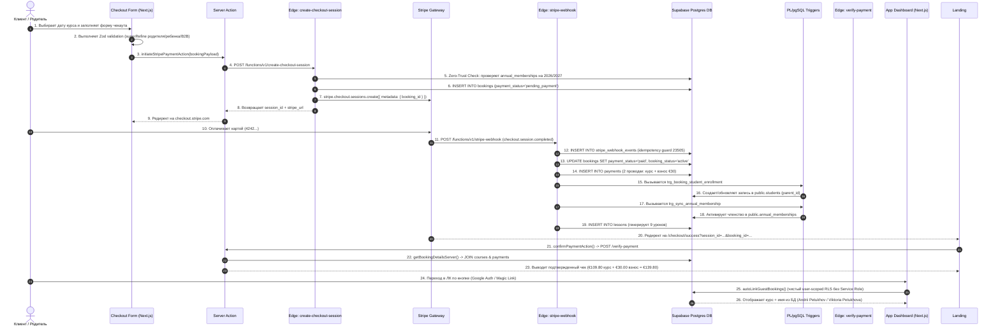

# Use Case: Покупка курса и Онбординг (Полная Библия Спецификации)

> **Документ**: Каноническая библия бизнес-процесса покупки курса, верстки, TS-файлов, триггеров БД, Edge Functions, Stripe, Vercel, RLS и обработки исключений  
> **Проект**: Atena School (`atena_school`)  
> **Версия**: 3.3 (Vercel Dynamic Cache & Complete Specification Edition)  
> **Целевая аудитория**: Разработчики, Архитекторы БД, Специалисты по безопасности, QA, Продукт-менеджеры  
> **Дата последнего обновления**: Июль 2026  

---

## 📖 1. Исполнительный Обзор (Executive Summary)

Документ представляет собой абсолютную каноническую спецификацию сквозного цикла чекаута и онбординга школы Atena School. Процесс охватывает весь путь пользователя от выбора курса анонимным посетителем на лендинге (`atenaschool.com`), клиентскую верстку и валидацию, серверную инициацию заказа в нулевом доверии (Zero-Trust), прием платежа шлюзом Stripe Gateway, фоновую обработку события через Webhooks и триггеры PostgreSQL, фиксацию бухгалтерского учета в таблицах БД и разграниченный доступ пользователей в Личном Кабинете (`app.atenaschool.com`).

### Архитектурные роли чекаута:
1. **Покупка Родителем для несовершеннолетнего ребенка (`isForChild = true`)**:
   * **Покупатель (Parent / Purchaser)**: Финансово и юридически ответственное лицо. Заполняет поля `purchaser_name`, `purchaser_email`, `purchaser_phone`, `purchaser_tax_code`. Запрашивает чек/фактуру. При входе в ЛК получает роль `role = 'parent'`.
   * **Ученик (Student / Child)**: Зачисляется на курс. Заполняет поля `student_name`, `student_email`, `student_phone`, `student_tax_code`, `student_birth_date`. При входе в ЛК получает роль `role = 'student'` и видит календарь посещений.
2. **Самостоятельная покупка взрослым учеником (`isForChild = false`)**:
   * Покупатель и Ученик — одно и то же физическое лицо. Данные из полей покупателя дублируются для ученика.

---

## 🗂️ 2. Каталог Файлов Исходного Кода и Компонентов (Complete File Index)

Ниже представлен полный реестр всех 18 файлов проекта, участвующих в сценарии покупки:

| № | Файл / Выполняемый компонент | Слой / Среда | Описание и зоны ответственности |
| :- | :--- | :--- | :--- |
| 1 | [`apps/landing/src/app/corsi/[id]/page.tsx`](file:///Users/krimson/PROJECTS/atena_school/apps/landing/src/app/corsi/%5Bid%5D/page.tsx) | Landing UI (Next.js) | Карточка курса, дата-пикер первой лекции, выбор расписания. |
| 2 | [`apps/landing/src/app/checkout/[id]/page.tsx`](file:///Users/krimson/PROJECTS/atena_school/apps/landing/src/app/checkout/%5Bid%5D/page.tsx) | Landing UI (Next.js) | Форма чекаута (верстка полей родителя, ребенка, B2B фактуры SDI/PEC, способа оплаты). |
| 3 | [`apps/landing/src/features/checkout/hooks/useCheckout.ts`](file:///Users/krimson/PROJECTS/atena_school/apps/landing/src/features/checkout/hooks/useCheckout.ts) | React State / Zod | Управление формой через React Hook Form, схема `checkoutSchema`, функция `superRefine()`. |
| 4 | [`apps/landing/src/app/actions/booking.ts`](file:///Users/krimson/PROJECTS/atena_school/apps/landing/src/app/actions/booking.ts) | Server Actions (Vercel) | `initiateStripePaymentAction()`, `confirmPaymentAction()`, `getBookingDetailsServer()`. |
| 5 | [`apps/landing/supabase/functions/create-checkout-session/index.ts`](file:///Users/krimson/PROJECTS/atena_school/apps/landing/supabase/functions/create-checkout-session/index.ts) | Edge Function (Deno) | Zero-Trust проверка взноса, вставка черновика в `bookings`, вызов Stripe Sessions API. |
| 6 | [`apps/landing/supabase/functions/stripe-webhook/index.ts`](file:///Users/krimson/PROJECTS/atena_school/apps/landing/supabase/functions/stripe-webhook/index.ts) | Edge Function (Deno) | Проверка сигнатуры Stripe, защитный лог `stripe_webhook_events`, 2 проводки в `payments`, генерирование 9 уроков. |
| 7 | [`apps/landing/supabase/functions/verify-payment/index.ts`](file:///Users/krimson/PROJECTS/atena_school/apps/landing/supabase/functions/verify-payment/index.ts) | Edge Function (Deno) | Серверное подтверждение статуса оплаты `payment_status = 'paid'`. |
| 8 | [`apps/landing/supabase/functions/_shared/utils.ts`](file:///Users/krimson/PROJECTS/atena_school/apps/landing/supabase/functions/_shared/utils.ts) | Edge Shared Utility | Общие утилиты CORS, инициализация `createSupabaseAdmin()` и `createStripe()`. |
| 9 | [`apps/landing/src/lib/utils/bookingScheduler.ts`](file:///Users/krimson/PROJECTS/atena_school/apps/landing/src/lib/utils/bookingScheduler.ts) | Business Logic Utility | Математика вычисления дат и слотов занятий с учетом таймзоны `Europe/Rome`. |
| 10 | [`apps/landing/src/app/checkout/success/page.tsx`](file:///Users/krimson/PROJECTS/atena_school/apps/landing/src/app/checkout/success/page.tsx) | Landing UI (Next.js) | Экран успехи и вывода чека заказов. |
| 11 | [`apps/landing/src/features/checkout/hooks/useCheckoutSuccess.ts`](file:///Users/krimson/PROJECTS/atena_school/apps/landing/src/features/checkout/hooks/useCheckoutSuccess.ts) | React State | Управление состояниями `verifying`, салют конфети, генерация Magic Link. |
| 12 | [`apps/landing/src/app/autenticazione/callback/route.ts`](file:///Users/krimson/PROJECTS/atena_school/apps/landing/src/app/autenticazione/callback/route.ts) | OAuth Callback | Перехват Google OAuth и редирект в ЛК. |
| 13 | [`apps/app/src/app/autenticazione/callback/route.ts`](file:///Users/krimson/PROJECTS/atena_school/apps/app/src/app/autenticazione/callback/route.ts) | OAuth Callback | Перехват Google OAuth на домене ЛК и вызов `autoLinkGuestBookings()`. |
| 14 | [`packages/api/src/services/dashboardService.ts`](file:///Users/krimson/PROJECTS/atena_school/packages/api/src/services/dashboardService.ts) | Package API Logic | Чистый RLS методы `autoLinkGuestBookings()` и `fetchUserBookingsEnriched()`. |
| 15 | [`apps/app/src/app/actions/dashboard.ts`](file:///Users/krimson/PROJECTS/atena_school/apps/app/src/app/actions/dashboard.ts) | Server Actions (Vercel) | `getDashboardDataAction()` — подтяжка имени пользователя из базы данных `public.users`. |
| 16 | [`apps/app/src/features/dashboard/hooks/useDashboard.ts`](file:///Users/krimson/PROJECTS/atena_school/apps/app/src/features/dashboard/hooks/useDashboard.ts) | React State (App) | Управление состоянием Личного Кабинета родителя/ученика. |
| 17 | [`apps/app/src/app/dashboard/page.tsx`](file:///Users/krimson/PROJECTS/atena_school/apps/app/src/app/dashboard/page.tsx) | Dashboard UI (Next.js) | Верстка панели ЛК, список уроков, кнопки разлогина и профиля. |
| 18 | [`apps/app/src/app/layout.tsx`](file:///Users/krimson/PROJECTS/atena_school/apps/app/src/app/layout.tsx) | App Layout (Next.js) | Настройка `force-dynamic` и `revalidate = 0` для отключения статического кэша Vercel. |
| 19 | `Supabase PL/pgSQL Triggers` | Database Kernel | Триггеры `trg_booking_student_enrollment`, `trg_sync_annual_membership`, `check_user_update`. |

---

## 📋 3. Диаграмма Последовательности (Full Sequence Diagram)



---

## 🔍 4. Пошаговое Описание Бизнес-Логики в Файлах Проекта

### Шаг 1: Выбор курса и расписания на лендинге
- **Файл**: `apps/landing/src/app/corsi/[id]/page.tsx`
- Пользователь выбирает дату первой лекции (например, `2026-07-30`) и временной слот (например, `Martedì e Giovedì 16:00-17:15`).
- Клиентский код формирует URL перехода: `/checkout/a2-key-for-schools?date=2026-07-30&time=Marted%C3%AC%20e%20Gioved%C3%AC%2016:00-17:15`.

### Шаг 2: Валидация и верстка формы чекаута
- **Файлы**: `apps/landing/src/features/checkout/hooks/useCheckout.ts`, `apps/landing/src/app/checkout/[id]/page.tsx`
- **Zod-схема (`checkoutSchema`)**:
  - Базовые обязательные поля: `firstName` (мин. 2 симв.), `lastName` (мин. 2 симв.), `email` (valid email), `phone` (мин. 6 симв.), `taxCode` (мин. 11 симв.).
  - **Правило `superRefine()` для родителя (`isForChild = true`)**:
    - `studentFirstName` и `studentLastName` становятся **обязательными**.
    - `purchaserTaxCode` становится **обязательным** (Codice Fiscale родителя для чека).
  - **Правило `superRefine()` для B2B фактуры (`needsCompanyInvoice = true`)**:
    - Обязательно должно быть заполнено хотя бы одно из двух полей: `sdiCode` (7 символов) или `pecEmail`.

### Шаг 3: Серверная инициация заказа (Server Action ➔ Edge Function)
- **Файл**: `apps/landing/src/app/actions/booking.ts` (`initiateStripePaymentAction()`)
- Функция собирает `bookingPayload` и делает POST-запрос к облачной Edge Function Supabase:
  `${process.env.NEXT_PUBLIC_SUPABASE_URL}/functions/v1/create-checkout-session`.

### Шаг 4: Бизнес-логика Edge Function `create-checkout-session`
- **Файл**: `apps/landing/supabase/functions/create-checkout-session/index.ts`
1. **Нормализация строк**:
   - `cleanEmail`, `actualStudentEmail` переводятся в `lowercase`.
   - `cleanStudentTaxCode`, `cleanPurchaserTaxCode`, `cleanSdiCode` переводятся в `UPPERCASE`.
2. **Zero-Trust Check Годового Взноса**:
   - Функция выполняет поиск в `public.annual_memberships` по утренней логике: `academic_year = '2026/2027'`, `status = 'active'`, совпадение по `tax_code ILIKE`, `email ILIKE` или `phone =`.
   - Если активный взнос найден ➔ `regFeeAmount = 0`.
   - Если взнос отсутствует ➔ `regFeeAmount = 3000` (30.00 EUR в центах).
3. **Создание чернового бронирования**:
   - В таблицу `public.bookings` вставляется запись со статусом `payment_status = 'pending_payment'`, куда пишутся **все 100% полей** покупателя и ребенка.
4. **Создание сессии Stripe**:
   - Вызывается `stripe.checkout.sessions.create()` с передачей `metadata: { booking_id: booking.id }` и позиций курса + годового взнос.
   - Возвращается `session_id` и `stripe_url` для редиректа.

### Шаг 5: Проведение оплаты на шлюзе Stripe
- Пользователь вводит карту (`4242 4242 4242 4242`) на домене `checkout.stripe.com`.
- Stripe списывает средства (€139.80) и генерирует `payment_intent` (`pi_...`).

### Шаг 6: Фоновая обработка платежа (Webhook & Triggers)
- **Файл**: `apps/landing/supabase/functions/stripe-webhook/index.ts`
1. **Защита от повторной обработки (Idempotency Guard)**:
   - Вставляется запись в `public.stripe_webhook_events`. Если Postgres возвращает код ошибки `23505` (unique_violation), функция завершается с кодом `200 OK` без повторной обработки.
2. **Обновление статуса заказа**:
   - `bookings.payment_status` изменяется на `'paid'`, `booking_status` на `'active'`.
3. **Фиксация Бухгалтерских Проводок в `public.payments`**:
   - Создаются 2 независимые финансовые проводки:
     - Запись 1: `type = 'payment'`, `amount = 109.80`, `provider_transaction_id = pi_...`
     - Запись 2: `type = 'registration_fee'`, `amount = 30.00`, `provider_transaction_id = pi_...`
4. **Генерация сетки уроков (`calculateLessonDates()`)**:
   - Вычисляются точные даты и время для 9 уроков с учетом часового пояса Европы/Рима (`Europe/Rome`), и записи вставляются в `public.lessons`.

### Шаг 7: Формирование чека успеха (`/checkout/success`)
- **Файлы**: `apps/landing/src/features/checkout/hooks/useCheckoutSuccess.ts`, `apps/landing/src/app/checkout/success/page.tsx`
1. Хук запускает `verifying = true`, блокируя карточку чека лоадером.
2. Серверный метод `getBookingDetailsServer(bookingId)` выполняет JOIN `courses` и считывает проводки из `public.payments`:
   - `courseName` = `courses.name` (`A2 Key for Schools`)
   - `coursePrice` = сумма транзакции `type = 'payment'` (€109.80)
   - `regFee` = сумма транзакции `type = 'registration_fee'` (€30.00)
   - `totalPaid` = `amount_paid` (€139.80)
3. Лоадер снимается, выводится гарантированный чек с праздничным салютом (конфети).

### Шаг 8: Вход в Личный Кабинет и Разграничение Прав (`apps/app`)
- **Файлы**: `packages/api/src/services/dashboardService.ts`, `apps/app/src/app/actions/dashboard.ts`
1. Пользователь входит через Google OAuth / Magic Link.
2. Вызывается метод `autoLinkGuestBookings(email, userId, supabase)`.
3. Запрос выполняется через стандартный клиент `supabase` в рамках чистого пользовательского RLS-контура:
   - Если зашел Родитель (`purchaser_email` = email) ➔ обновляет `public.users`: `role = 'parent'`, `full_name = 'Andrii Petukhov'`.
   - Если зашел Ученик (`student_email` = email) ➔ обновляет `public.users`: `role = 'student'`, `full_name = 'Viktoria Petukhova'`.
4. `getDashboardDataAction` подтягивает имя из `public.users` и перекрывает им метаданные профиля Google.

---

## ⚙️ 5. Полный Реестр Триггеров PostgreSQL и PL/pgSQL Функций

### 1. Триггер `trg_booking_student_enrollment` на `public.bookings`
* **Функция**: `handle_booking_student_enrollment()` (`SECURITY DEFINER`)
* **Срабатывание**: `AFTER INSERT OR UPDATE ON public.bookings`
* **Логика**:
  - Проверяет наличие ученика в `public.students` по `student_email` или `student_tax_code`.
  - Если ученик не найден ➔ создаёт новую карточку в `public.students` со ссылкой на родительский аккаунт `parent_id`.
  - Если найден ➔ обновляет `annual_fee_paid = true` (если оплачен взнос) и связывает `bookings.student_id`.

### 2. Триггер `trg_sync_annual_membership` на `public.bookings`
* **Функция**: `sync_annual_membership_on_booking_payment()` (`SECURITY DEFINER`)
* **Срабатывание**: `AFTER INSERT OR UPDATE OF payment_status ON public.bookings`
* **Логика**:
  - При переходе `payment_status` в `'paid'` и `registration_fee > 0` создаёт или обновляет активную запись в `public.annual_memberships` на учебный год `2026/2027` со сроком действия до `31.08.2027`.

### 3. Триггер `on_auth_user_created` на `auth.users`
* **Функция**: `handle_new_user()` (`SECURITY DEFINER`)
* **Срабатывание**: `AFTER INSERT ON auth.users`
* **Логика**:
  - Автоматически создает профиль пользователя в `public.users` при регистрации, устанавливая начальную роль `'student'`.

### 4. Триггер `enforce_user_role_protection` на `public.users`
* **Функция**: `check_user_update()` (`SECURITY DEFINER`)
* **Срабатывание**: `BEFORE UPDATE ON public.users`
* **Логика**:
  - Блокирует ручное изменение колонок `role`, `is_active`, `notes` обычным пользователем, разрешая их изменение только админам или при установленном флаге `app.bypass_user_guard`.

---

## 🛡️ 6. Аудит Безопасности и Полный Спектр RLS-Политик (Security & RLS)

Ниже представлен **полный список из 22 RLS-политик**, действующих во всех 7 таблицах базы данных:

### 1. Таблица `public.bookings` (Заказы)
```sql
-- 1. Выборка заказов пользователем (родитель/ученик)
CREATE POLICY "Allow users to read own bookings" ON public.bookings FOR SELECT TO public
USING ((auth.uid() = user_id) OR (student_email IS NOT NULL AND lower(student_email) = lower(auth.jwt() ->> 'email')) OR (purchaser_email IS NOT NULL AND lower(purchaser_email) = lower(auth.jwt() ->> 'email')) OR (session_id = COALESCE(NULLIF(current_setting('request.headers', true)::json ->> 'x-session-id', ''), '')));

-- 2. Публичное добавление нового бронирования на чекауте
CREATE POLICY "Allow public insert for bookings" ON public.bookings FOR INSERT TO public
WITH CHECK (payment_status = ANY (ARRAY['in_cart', 'pending_payment', 'reserved']));

-- 3. Привязка гостевого заказа авторизованным юзером
CREATE POLICY "Allow users to link guest bookings by email" ON public.bookings FOR UPDATE TO public
USING ((auth.uid() = user_id) OR (student_email IS NOT NULL AND lower(student_email) = lower(auth.jwt() ->> 'email')) OR (purchaser_email IS NOT NULL AND lower(purchaser_email) = lower(auth.jwt() ->> 'email')))
WITH CHECK (auth.uid() = user_id);

-- 4. Полный доступ для администратора
CREATE POLICY "Allow admin all for bookings" ON public.bookings FOR ALL TO authenticated
USING (EXISTS (SELECT 1 FROM users WHERE users.id = auth.uid() AND users.role = 'admin'));
```

### 2. Таблица `public.users` (Профили пользователей)
```sql
-- SELECT: пользователь видит свой профиль, админ — все, учитель — студентов
CREATE POLICY "users_select_policy" ON public.users FOR SELECT TO public
USING ((id = auth.uid()) OR (get_user_role() = 'admin') OR (get_user_role() = 'teacher' AND role = 'student'));

-- UPDATE: редактирование своего профиля или админом
CREATE POLICY "users_update_policy" ON public.users FOR UPDATE TO public
USING ((id = auth.uid()) OR (get_user_role() = 'admin'));
```

### 3. Таблица `public.students` (Карточки учеников)
```sql
-- SELECT: студент видит свою карточку, админы и учителям доступен список
CREATE POLICY "students_select_policy" ON public.students FOR SELECT TO public
USING ((get_user_role() = ANY (ARRAY['admin', 'teacher'])) OR (id = auth.uid()));
```

### 4. Таблица `public.annual_memberships` (Годовые взносы)
```sql
-- SELECT: пользователь видит свои членские взносы
CREATE POLICY "Users can view own annual_memberships" ON public.annual_memberships FOR SELECT TO public
USING (auth.uid() = user_id);
```

### 5. Таблица `public.payments` (Финансовые проводки)
```sql
-- SELECT: пользователь видит свои чеки и транзакции
CREATE POLICY "Users can view own payments" ON public.payments FOR SELECT TO public
USING (auth.uid() = user_id);
```

### 6. Таблица `public.lessons` (Уроки)
```sql
-- SELECT: выборка уроков забронированного курса
CREATE POLICY "Allow public read for own booking lessons" ON public.lessons FOR SELECT TO public
USING (EXISTS (SELECT 1 FROM bookings WHERE bookings.id = lessons.booking_id AND (bookings.user_id = auth.uid() OR bookings.session_id = current_setting('request.headers', true)::json ->> 'x-atena-session')));
```

### 🔐 7. Гарантии Безопасности (Security Guarantees)

1. **Отсутствие `SUPABASE_SERVICE_ROLE_KEY` в ЛК**: 
   Все операции в ЛК (`dashboardService.ts`) выполняются исключительно в рамках пользовательского RLS-контура со стандартным JWT-токеном. `SUPABASE_SERVICE_ROLE_KEY` полностью удален из служб ЛК.
2. **Криптографическая изоляция чужих данных**: 
   Пользователь A физически не может прочитать или изменить заказы Пользователя B. Ядро PostgreSQL проверяет подлинность подписанного JWT-токена пользователя (`auth.jwt() ->> 'email'`) непосредственно при каждой операции на уровне СУБД.
3. **Изоляция секретов и ключей**: 
   Все секретные ключи Stripe (`STRIPE_SECRET_KEY`, `STRIPE_WEBHOOK_SECRET`) и ключи Supabase Service Role хранятся исключительно в закрытых серверных переменных окружения (`.env`), внесены в `.gitignore` и никогда не высылаются в клиентские JS-бандлы браузера.

---

## 📊 8. Полная Матрица Проверки 7 Таблиц БД (Audit Matrix)

| Таблица | Проверяемая колонка | Ожидаемое значение | Правило валидации |
| :--- | :--- | :--- | :--- |
| `public.bookings` | `purchaser_email` | `petukhov.1205@gmail.com` | Должен точно совпадать с почтой родителя. |
| | `purchaser_phone` | `+380665237393` | Формат E.164. |
| | `purchaser_tax_code` | `SHDFJKGSDHFJHSDGF` | Normalized UPPERCASE. |
| | `student_name` | `Viktoria Petukhova` | Имя ученика из формы. |
| | `student_email` | `petukhov.1337@gmail.com` | Почта ребенка. |
| | `student_phone` | `+432763564723` | Телефон ребенка из формы. |
| | `student_tax_code` | `PTBNS2345236754723` | Codice Fiscale ребенка (UPPERCASE). |
| | `amount_paid` | `139.8` | Итоговая сумма заказа. |
| | `registration_fee` | `30` | Размер годового взноса. |
| `public.students` | `full_name` | `Viktoria Petukhova` | Имя ребенка в карточке. |
| | `parent_id` | UUID аккаунта родителя | Автоматическая привязка триггером. |
| | `annual_fee_paid` | `true` | Флаг оплаты взноса. |
| `public.annual_memberships` | `academic_year` | `'2026/2027'` | Учебный сезон. |
| | `status` | `'active'` | Статус взноса. |
| | `expires_at` | `'2027-08-31 23:59:59+00'` | Конец академического года. |
| `public.payments` | Запись 1: `type='payment'` | `109.80` EUR | Проводка за курс. |
| | Запись 2: `type='registration_fee'` | `30.00` EUR | Проводка за взнос. |
| `public.lessons` | Количество записей | `9` | Ровно 9 календарных уроков. |
| `public.stripe_webhook_events`| `event_type` | `'checkout.session.completed'` | Подтвержденный лог Stripe. |
| `public.users` | `full_name` | `Andrii Petukhov` (`parent`) / `Viktoria Petukhova` (`student`) | Профили пользователей из формы. |

---

## 🚨 9. Матрица Исключений и Граничных Кейсов (Edge Cases & Exception Handling)

| Граничный кейс / Ошибка | Какая система обрабатывает | Поведение системы |
| :--- | :--- | :--- |
| **Повторный Webhook от Stripe** | Edge Function `stripe-webhook` | Ловится уникальным индексом `stripe_event_id` в `stripe_webhook_events`. Postgres отдаёт код `23505`. Функция логирует `Event already processed` и возвращает `200 OK`. |
| **Ученик уже оплачивал взнос €30 в этом году** | Edge Function `create-checkout-session` | Выполняется Zero-Trust поиск в `annual_memberships`. Если найден активный взнос на `2026/2027`, `regFeeAmount` принудительно обнуляется. |
| **Задержка сети при переходе на `/checkout/success`** | Hook `useCheckoutSuccess` | Состояние `verifying` держит лоадер до тех пор, пока с сервера не вернутся данные. Экран никогда не показывает "нулевой" чек. |
| **Разные языковые имена в Google Auth профилях** | Action `getDashboardDataAction` | Имя приветствия берется из `public.users.full_name`, полностью игнорируя метаданные профилей Google. |
| **Статический кэш Vercel (`cache: PRERENDER`) на дашборде ЛК** | App Layout `apps/app/src/app/layout.tsx` | Директивы `export const dynamic = 'force-dynamic'` и `revalidate = 0` принудительно переводят роуты в режим `dynamic`, предотвращая отдачу старого закэшированного HTML. |
| **Незарегистрированный гость без Google аккаунта** | Hook `useCheckoutSuccess` | Автоматически генерирует и отправляет Magic Link авторизации через `dispatchMagicLinkAction(email)` на почту клиента. |
