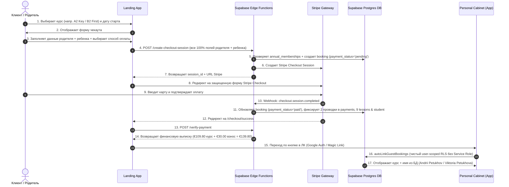

# Use Case: Покупка курса и Онбординг (End-to-End Flow Specification)

> **Документ**: Полная спецификация бизнес-процесса покупки курса, безопасности, RLS и аудит-матрицы  
> **Проект**: Atena School (`atena_school`)  
> **Целевая аудитория**: Разработчики, Архитекторы БД, QA, Специалисты по безопасности  
> **Последнее обновление**: Июль 2026 (Версия 2.0 — Senior Architecture Update)  

---

## 🎯 1. Обзор Use Case

Этот документ описывает полный сквозной жизненный цикл покупки учебного курса анонимным клиентом на лендинге (`atenaschool.com`), обработку платежа через Stripe Gateway, автоматическое формирование бухучета в PostgreSQL Supabase и предоставление разграниченного доступа в Личном Кабинете (`app.atenaschool.com`).

Сценарий поддерживает два ключевых варианта оформления:
1. **Покупка родителем для несовершеннолетнего ребенка** (`isForChild = true`):
   - **Покупатель**: Родитель (ответственен за оплату, фактуру B2B/B2C, чеки, налоговый код *Codice Fiscale*).
   - **Ученик**: Ребенок (прохождение уроков, расписание, посещаемость).
2. **Самостоятельная покупка взрослым учеником** (`isForChild = false`):
   - Покупатель и Ученик — одно и то же физическое лицо.

---

## 👥 2. Участники (Actors) & Компоненты

* **Анонимный Гость / Покупатель**: Посетитель сайта, оформляющий заказ.
* **Ученик**: Лицо, проходящее обучение по выбранному курсу.
* **Landing App (`apps/landing`)**: Фронтенд на Next.js (Чекаут, Чек успеха, Интеграция со Stripe).
* **Personal Cabinet App (`apps/app`)**: Личный Кабинет студента/родителя (Уроки, Профиль, Календарь).
* **Supabase Cloud Edge Functions**:
  * `create-checkout-session`: Серверная инициация заказа и Stripe Session (Zero-Trust).
  * `stripe-webhook`: Фоновая обработка платежных событий Stripe (`checkout.session.completed`).
  * `verify-payment`: Серверная подтверждающая выписка чека при возврате клиента.
* **Stripe Payment Gateway**: Внешний шлюз приема карт (`pi_...`, `cs_test_...`).
* **Supabase PostgreSQL Database**: Реестр БД (`bookings`, `users`, `students`, `annual_memberships`, `lessons`, `payments`, `stripe_webhook_events`).

---

## 📋 3. Пошаговая схема процесса (Mermaid Diagram)



---

## 🔍 4. Детальное описание каждого шага

### Шаг 1: Выбор курса и расписания
* Клиент открывает страницу курса (например, `/corsi/a2-key-for-schools`).
* Выбирает дату старта (например, `30 июля 2026`) и слот расписания (`16:00-17:15`).
* Система автоматически вычисляет сетку занятий (9 уроков до 27 августа).

### Шаг 2: Заполнение формы чекаута (`/checkout/[id]`)
* Клиент заполняет:
  * **Флаг родителя**: `isForChild = true`.
  * **Покупатель (Родитель)**: Имя (`Andrii`), Фамилия (`Petukhov`), Email (`petukhov.1205@gmail.com`), Телефон (`+380665237393`), Codice Fiscale (`SHDFJKGSDHFJHSDGF`).
  * **Ученик (Ребенок)**: Имя (`Viktoria`), Фамилия (`Petukhova`), Email (`petukhov.1337@gmail.com`), Телефон (`+432763564723`), Дата рождения (`10.10.2010`), Codice Fiscale (`PTBNS2345236754723`).
  * **Годовой взнос**: `Quota d'iscrizione annuale (€30.00)`.
  * **Способ оплаты**: `Stripe`.

### Шаг 3: Серверная инициация (`create-checkout-session`)
1. Сервер производит **Zero-Trust проверку** на наличие активного годового взноса на `2026/2027` в `public.annual_memberships`. Если членство отсутствует, в чек добавляется €30.00.
2. В таблице `public.bookings` создается запись со статусом `payment_status = 'pending'`, куда сохраняются **все 100% введенных данных** родителя и ребенка.
3. Формируется сессия Stripe на полную сумму (€109.80 курс + €30.00 взнос = €139.80).

### Шаг 4: Оплата через Stripe
* Клиент переходит на форму Stripe (`checkout.stripe.com`) и вводит данные карты (`4242...`).

### Шаг 5: Фоновая обработка платежа (Webhook & Triggers)
1. Stripe посылает событие `checkout.session.completed` в `stripe-webhook`.
2. Функция переводит бронирование в `payment_status = 'paid'` и `booking_status = 'active'`.
3. В таблице `public.payments` создаются 2 точные бухгалтерские проводки:
   - `type = 'payment'` ➔ €109.80 (цена курса A2 Key)
   - `type = 'registration_fee'` ➔ €30.00 (взнос)
4. Триггер `trg_booking_student_enrollment` автоматически создает карточку ученика в `public.students` со ссылкой на родителя `parent_id`.
5. Триггер `trg_sync_annual_membership` активирует взнос в `public.annual_memberships`.
6. Генерируется ровно 9 календарных уроков в `public.lessons`.

### Шаг 6: Финансовый чек успеха (`/checkout/success`)
* Компонент ожидает завершения подтверждения с сервера (`verifying`).
* Серверный метод `getBookingDetailsServer` выполняет JOIN с `public.courses` и считывает проводки из `public.payments`:
  - **Servizio**: `A2 Key for Schools` (из `courses.name`)
  - **Prezzo corso**: `€109.80` (из транзакции `payments.type = 'payment'`)
  - **Quota iscrizione**: `€30.00` (из транзакции `payments.type = 'registration_fee'`)
  - **Totale**: `€139.80` (из `bookings.amount_paid`)
* *Никакого хардкода или вычитаний на фронтенде — 100% бухгалтерская выписка из БД.*

### Шаг 7: Авторизация и доступ в ЛК (`app.atenaschool.com/dashboard`)
* При входе пользователя под своим Google-аккаунтом запускается `autoLinkGuestBookings`:
  * **Если зашел Родитель (`petukhov.1205@gmail.com`)**:
    * Автоматически устанавливается `role = 'parent'` и имя `Andrii Petukhov` в `public.users`.
    * Курс отображается в дашборде родителя.
  * **Если зашел Ученик (`petukhov.1337@gmail.com`)**:
    * Устанавливается `role = 'student'` и имя `Viktoria Petukhova` в `public.students` / `public.users`.
    * Ученик видит свое расписание и уроки.

---

## 🏛️ 5. Архитектура безопасности и RLS (Security Architecture)

1. **Zero Service Role Key в ЛК**:
   Служба `dashboardService.ts` **НЕ использует** `SUPABASE_SERVICE_ROLE_KEY`. Все запросы к бронированиям выполняются строго через стандартный авторизованный клиент Supabase под RLS-контролем текущего пользователя.
2. **Postgres Row Level Security (RLS)**:
   Доступ к `public.bookings` защищен на уровне ядра PostgreSQL:
   ```sql
   ((auth.uid() = user_id) 
    OR (student_email IS NOT NULL AND lower(student_email) = lower(auth.jwt() ->> 'email')) 
    OR (purchaser_email IS NOT NULL AND lower(purchaser_email) = lower(auth.jwt() ->> 'email')))
   ```
3. **Независимость от порядка входа**:
   Не имеет значения, кто первым зашел в ЛК (родитель или ребенок) — RLS проверяет криптографический JWT-токен пользователя и отдает заказ каждому авторизованному лицу.
4. **Приоритет имен из базы данных**:
   Имена в шапке ЛК берутся из профиля `public.users` (`Andrii Petukhov` / `Viktoria Petukhova`), полностью перекрывая имена профилей Google OAuth.

---

## 📊 6. Матрица проверки 7 таблиц БД (Audit Matrix)

| Таблица | Обязательные колонки | Ожидаемые значения | Назначение |
| :--- | :--- | :--- | :--- |
| `public.bookings` | `purchaser_email`, `purchaser_phone`, `purchaser_tax_code`, `student_email`, `student_phone`, `student_tax_code`, `amount_paid`, `registration_fee` | 100% полное заполнение без `null` | Центральный реестр заказов. |
| `public.students` | `first_name`, `last_name`, `email`, `phone`, `tax_code`, `annual_fee_paid` | `Viktoria`, `Petukhova`, `+432763564723`, `PTBNS...`, `true` | Карточка ученика в учебной части. |
| `public.annual_memberships` | `academic_year`, `status`, `tax_code`, `email`, `booking_id` | `'2026/2027'`, `'active'`, `PTBNS...`, `petukhov.1337@gmail.com` | Единый реестр оплаченных взносов. |
| `public.payments` | 2 записи: `type='payment'` и `type='registration_fee'` | `109.80` и `30.00` EUR, `status='succeeded'` | Бухгалтерские проводки заказа. |
| `public.lessons` | 9 записей уроков | Даты с 30.07 по 27.08 по расписанию | Сетка календарных занятий. |
| `public.stripe_webhook_events` | `event_type`, `stripe_event_id`, `processed_at` | `'checkout.session.completed'` | Лог обработанных событий Stripe. |
| `public.users` | `email`, `full_name`, `role`, `phone` | `Andrii Petukhov` (`parent`) и `Viktoria Petukhova` (`student`) | Учетные записи пользователей в Auth. |
