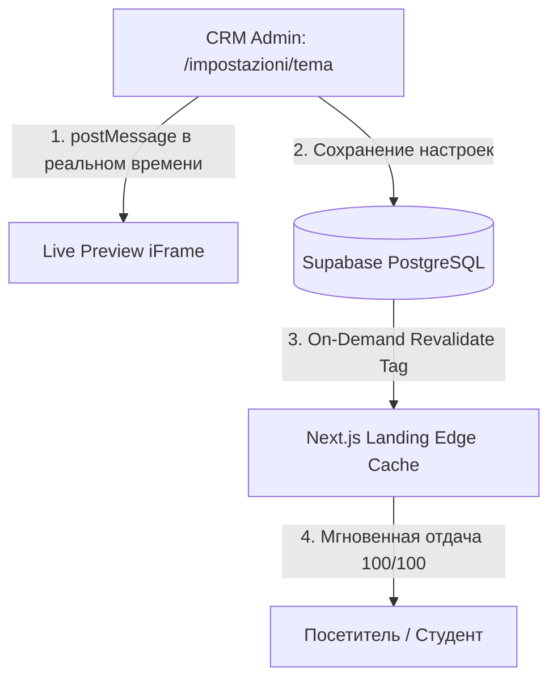

# White-Label Theme & Section CMS Specification

> **Назначение документа:** Полная инженерная спецификация для реализации White-Label системы брендинга, управления секциями лендинга и кастомных страниц с живым предпросмотром (Live Preview). Документ написан как пошаговое руководство для разработчика или AI-агента.

---

## 1. Контекст и Бизнес-Цель (Зачем и Почему)

### Проблема:
Платформа Atena School разрабатывается как **White-Label SaaS**. При подключении 2-го, 3-го и последующих заказчиков (других языковых школ/центров) возникнет потребность:
1. Использовать свои фирменные цвета, логотипы, фавиконы, шрифты и радиусы скругления кнопок.
2. Скрывать/показывать и менять порядок готовых блоков на главной странице (Hero, Курсы, Отзывы, Cambridge-баннер, Тест английского, Контакты).
3. Редактировать тексты и изображения без участия программиста.
4. Создавать произвольные страницы (например, `/chi-siamo`, `/summer-camp`, `/certificazioni`).

### Ограничения:
* **Нельзя использовать сторонние тяжелые CMS (WordPress, Wix):** это разрушит архитектуру чекаута, снизит Lighthouse с 100 до 40 и создаст рассинхрон базы данных.
* **0ms задержки для клиентов:** сайт должен отдаваться из Edge CDN (ISR кэш), без задержек ожидания базы данных при каждом заходе.
* **Идеальное SEO и Core Web Vitals:** серверный рендеринг (SSR/SSG), отсутствие CLS (сдвигов макета) и TBT.

---

## 2. Архитектурная модель (Shopify-like Pattern)

Архитектура состоит из 4 связанных модулей:



1. **Theme Engine (CSS Variables):** Цвета и шрифты хранятся в БД и инжектятся на лендинге, в личном кабинете (`apps/app`) и админке (`apps/admin`) как CSS-переменные: `var(--brand-primary)`, `var(--brand-accent)`, etc.
2. **Section Manager (Секции-кирпичики):** Главная страница рендерит массив блоков согласно их порядку (`order`) и статусу (`enabled: true/false`).
3. **Dynamic CMS Pages:** Роут `apps/landing/src/app/[slug]/page.tsx` рендерит произвольные страницы из таблицы `cms_pages`.
4. **Live Preview Engine:** В админке слева — форма редактирования, справа — `<iframe>` с лендингом. При изменении полей данные летят через `window.postMessage` в iframe для мгновенного предпросмотра без перезагрузки.

---

## 3. Схема Базы Данных (PostgreSQL / Supabase)

### 3.1. Расширение таблицы `school_profiles` (Брендинг и Тема)
```sql
ALTER TABLE public.school_profiles
ADD COLUMN IF NOT EXISTS theme_config JSONB DEFAULT '{
  "colors": {
    "primary": "#043569",
    "primary_hover": "#032852",
    "secondary": "#E69F00",
    "accent": "#00A896",
    "background": "#FFFFFF",
    "surface": "#F8FAFC",
    "text_primary": "#0F172A",
    "text_muted": "#64748B"
  },
  "typography": {
    "font_family": "Inter",
    "heading_font_family": "Plus Jakarta Sans"
  },
  "styling": {
    "border_radius": "16px",
    "button_radius": "12px",
    "card_style": "glassmorphic"
  }
}'::jsonb;
```

### 3.2. Таблица `landing_sections` (Управление блоками)
```sql
CREATE TABLE IF NOT EXISTS public.landing_sections (
  id UUID PRIMARY KEY DEFAULT gen_random_uuid(),
  section_key VARCHAR(50) NOT NULL UNIQUE, -- 'hero', 'stats', 'courses', 'cambridge', 'about', 'testimonials', 'placement_test', 'contact'
  name_it VARCHAR(100) NOT NULL,
  is_enabled BOOLEAN NOT NULL DEFAULT true,
  display_order INT NOT NULL DEFAULT 0,
  content JSONB DEFAULT '{}'::jsonb, -- Кастомные тексты и медиа для секции
  created_at TIMESTAMPTZ DEFAULT NOW(),
  updated_at TIMESTAMPTZ DEFAULT NOW()
);

-- Начальные дефолтные секции
INSERT INTO public.landing_sections (section_key, name_it, is_enabled, display_order, content) VALUES
('hero', 'Hero Banner', true, 1, '{"badge": "Scuola di Lingue Certificata", "cta_text": "Scopri i Corsi"}'::jsonb),
('stats', 'Statistiche e Risultati', true, 2, '{"students_count": 500, "success_rate": "98%"}'::jsonb),
('courses', 'Catalogo Corsi', true, 3, '{"title": "I Nostri Corsi di Lingua", "limit": 6}'::jsonb),
('cambridge', 'Preparazione Cambridge', true, 4, '{"title": "Centro Preparazione Ufficiale"}'::jsonb),
('about', 'Chi Siamo', true, 5, '{"title": "Il Nostro Metodo"}'::jsonb),
('testimonials', 'Recensioni e Storie', true, 6, '{"title": "Cosa Dicono i Nostri Studenti"}'::jsonb),
('placement_test', 'Test Inglese Online', true, 7, '{"title": "Valuta il tuo livello in 5 minuti"}'::jsonb),
('contact', 'Modulo di Contatto', true, 8, '{"title": "Richiedi Informazioni"}'::jsonb)
ON CONFLICT (section_key) DO NOTHING;
```

### 3.3. Таблица `cms_pages` (Произвольные страницы)
```sql
CREATE TABLE IF NOT EXISTS public.cms_pages (
  id UUID PRIMARY KEY DEFAULT gen_random_uuid(),
  slug VARCHAR(100) NOT NULL UNIQUE, -- 'chi-siamo', 'convenzioni', 'summer-camp'
  title_it VARCHAR(255) NOT NULL,
  title_en VARCHAR(255),
  content_html TEXT NOT NULL,
  seo_title VARCHAR(255),
  seo_description TEXT,
  og_image_url TEXT,
  is_published BOOLEAN NOT NULL DEFAULT true,
  created_at TIMESTAMPTZ DEFAULT NOW(),
  updated_at TIMESTAMPTZ DEFAULT NOW()
);
```

---

## 4. Пакет `@atena/core` — Единый источник правды

В `packages/core/src/system/`:
1. `theme.service.ts`:
   * `getSchoolTheme(supabase)`: возвращает `theme_config` с fallback на дефолтную палитру.
   * `generateCssVariables(theme)`: генерирует строку `:root { --primary: ... }` для инжекта в `layout.tsx`.
2. `landing-sections.service.ts`:
   * `getLandingSections(supabase)`: возвращает отсортированный список активных секций.
   * `updateLandingSections(supabase, sections)`: сохраняет порядок и видимость.
3. `cms-pages.service.ts`:
   * `getCmsPageBySlug(supabase, slug)`
   * `listCmsPages(supabase)`
   * `upsertCmsPage(supabase, pageData)`

---

## 5. Лендинг (`apps/landing`)

### 5.1. Инжекция темы в `apps/landing/src/app/layout.tsx`
Вставляется серверный тег `<style>` в `<head>`:
```tsx
const theme = await getSchoolTheme(supabase);
const cssVars = generateCssVariables(theme);

return (
  <html lang="it">
    <head>
      <style dangerouslySetInnerHTML={{ __html: cssVars }} />
    </head>
    <body className="font-brand bg-surface text-primary-text">
      {children}
      <LivePreviewListener />
    </body>
  </html>
);
```

### 5.2. Tailwind Config (`apps/landing/tailwind.config.ts`)
Заменяем жестко зашитые цвета на CSS-переменные:
```ts
colors: {
  brand: {
    primary: 'var(--brand-primary)',
    'primary-hover': 'var(--brand-primary-hover)',
    secondary: 'var(--brand-secondary)',
    accent: 'var(--brand-accent)',
  },
  surface: 'var(--brand-surface)',
}
```

### 5.3. Динамический рендеринг секций в `apps/landing/src/app/page.tsx`
```tsx
const SECTION_COMPONENTS: Record<string, React.ComponentType<any>> = {
  hero: HeroSection,
  stats: StatsSection,
  courses: CoursesSection,
  cambridge: CambridgeSection,
  about: AboutSection,
  testimonials: TestimonialsSection,
  placement_test: PlacementTestBanner,
  contact: ContactSection,
};

export default async function IndexPage() {
  const sections = await getLandingSections(supabase);

  return (
    <main>
      {sections.filter(s => s.is_enabled).map(section => {
        const Component = SECTION_COMPONENTS[section.section_key];
        if (!Component) return null;
        return <Component key={section.section_key} content={section.content} />;
      })}
    </main>
  );
}
```

### 5.4. Live Preview слушатель (`LivePreviewListener.tsx`)
```tsx
'use client';

import { useEffect } from 'react';

export function LivePreviewListener() {
  useEffect(() => {
    if (process.env.NODE_ENV !== 'production' || window.self !== window.top) {
      const handleMessage = (event: MessageEvent) => {
        if (event.data?.type === 'ATENA_THEME_UPDATE') {
          const { colors } = event.data.payload;
          const root = document.documentElement;
          if (colors.primary) root.style.setProperty('--brand-primary', colors.primary);
          if (colors.secondary) root.style.setProperty('--brand-secondary', colors.secondary);
        }
      };
      window.addEventListener('message', handleMessage);
      return () => window.removeEventListener('message', handleMessage);
    }
  }, []);

  return null;
}
```

---

## 6. CRM Админка (`apps/admin`)

Создать страницу **`/impostazioni/tema-e-landing`**:
1. **Макет (Split View):**
   * **Левая колонка (40% ширины):**
     * Вкладка 1: **Палитра и Брендинг** (Color Pickers для Primary, Secondary, Background, загрузка логотипа).
     * Вкладка 2: **Секции Главной** (Переключатели видимости + стрелки `[▲] [▼]` для сортировки).
     * Вкладка 3: **Тексты и Контент** (Редактор Hero, FAQ, Отзывов).
     * Вкладка 4: **Страницы** (Список и создание страниц `/slug`).
   * **Правая колонка (60% ширины):**
     * Верхний тулбар с переключателем экранов: `[📱 Mobile (375px)]` `[💻 Desktop (100%)]` `[🔄 Обновить]`.
     * `<iframe>` с `src="http://localhost:3000?preview=true"`.
2. **Двусторонняя связь:**
   * При движении любого ползунка или вводе текста в левой колонке:
     `iframeRef.current.contentWindow.postMessage({ type: 'ATENA_THEME_UPDATE', payload: currentFormValues }, '*');`
   * Нажатие **«Salva e Pubblica»** отправляет `PATCH /admin/theme-and-landing` на бэкенд, сохраняет данные в Supabase и запускает `revalidateTag('landing-theme')`.

---

## 7. Пошаговый чек-лист для реализации (Execution Steps)

Когда придёт время делать эту задачу, выполняй строго по порядку:

```markdown
1. [ ] Database Migration: Создать миграцию с theme_config, landing_sections, cms_pages.
       → verify: запустить на DEV и PROD базах данных.
2. [ ] Core Package: Реализовать theme.service.ts и landing-sections.service.ts в @atena/core.
       → verify: pnpm --filter @atena/core test
3. [ ] Landing CSS: Подключить CSS Variables в index.css и tailwind.config.ts лендинга.
       → verify: смена переменной в браузере меняет цвет кнопок.
4. [ ] Landing Dynamic Sections: Отрефакторить page.tsx на чтение секций из landing_sections.
       → verify: выключение секции в БД скрывает её на главной.
5. [ ] Dynamic CMS Route: Создать apps/landing/src/app/[slug]/page.tsx.
       → verify: переход по /chi-siamo открывает страницу из cms_pages.
6. [ ] Admin CRM UI: Сделать страницу /impostazioni/tema-e-landing с Live Preview iFrame.
       → verify: изменения в форме мгновенно отображаются в iFrame справа.
7. [ ] Edge Invalidation: Добавить on-demand revalidation роут для сброса кэша при сохранении.
       → verify: сохранение в CRM обновляет публичный сайт за <50мс.
```

---

## 8. Итог
Эта архитектура:
* Не требует сторонних CMS или WordPress.
* Сохраняет 100% модульность монорепозитория.
* Обеспечивает мгновенный отклик сайта (Edge ISR).
* Позволяет настраивать нового заказчика за 5 минут прямо из браузера.
