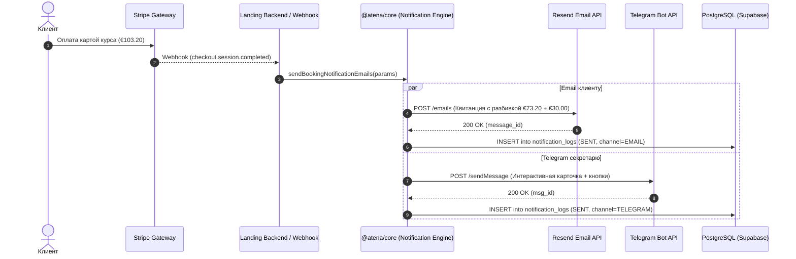
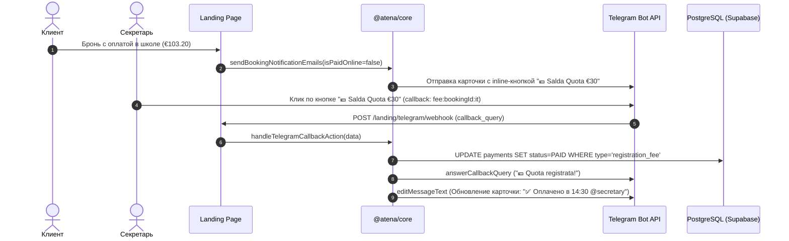

# 📊 08. Бизнес-анализ, Системный анализ и QA Test Plan

Данный документ связывает бизнес-требования, системные потоки данных и сценарии верификации для **Бизнес-аналитиков (BA)**, **Системных аналитиков (SA)** и **Инженеров по тестированию (QA)**.

---

# 💼 Часть 1. Бизнес-анализ (Business Analysis)

## 1.1. Бизнес-правила (Business Rules)

* **BR-01 (Правило двух платежей):** Сумма каждого бронирования (`total_amount`) строго разделяется на две составляющие:
  1. `registration_fee` — ежегодный членский взнос ассоциации (**Quota Associativa / Iscrizione = €30.00**).
  2. `course_price` — стоимость обучения (**Quota Corso**).
  *В письмах клиенту и алертов секретариату эти суммы всегда отображаются раздельно.*
* **BR-02 (Разделение покупателя и студента `isForChild`):**
  * Если заказ оформляет родитель за ребенка (`isForChild = true`):
    * Финансовый плательщик (`purchaser_*`) = родитель (получает финансовые чеки на свой email).
    * Студент (`student_*`) = несовершеннолетний (на него выпускается членская карта `annual_memberships` и учитывается `student_tax_code`).
* **BR-03 (Фискальные реквизиты Италии):** Для выписки электронного счета-фактуры (Fattura Elettronica) система фиксирует и отображает код **SDI** (7 символов) и адрес **PEC** (сертифицированная электронная почта).
* **BR-04 (White-Label):** Все уведомления брендируются параметрами конкретной школы (название, юридический адрес, телефон секретариата, банковский IBAN, логотип) из `app_settings`.
* **BR-05 (SLA доставки):**
  * Транзакционные письма клиенту (Email) должны отправляться в течение **< 3 секунд** после события.
  * Алерты секретариату в Telegram должны поступать в течение **< 1 секунды** после события.

---

## 1.2. Пользовательские сценарии (Use Cases)

| Use Case ID | Наименование | Акторы | Триггер | Ожидаемый результат |
|---|---|---|---|---|
| **UC-01** | Оплата курса онлайн (Stripe) | Студент / Родитель | Успешная оплата в Stripe Checkout | Клиент получает квитанцию на Email; секретариат получает карточку в Telegram и Email-алерт. |
| **UC-02** | Бронирование с оплатой на месте | Студент / Родитель | Подтверждение формы на лендинге | Клиент получает Email с реквизитами IBAN; в Telegram секретариата поступает карточка с кнопками быстрого закрытия оплаты. |
| **UC-03** | Заявка из контактной формы | Посетитель сайта | Отправка формы `/landing/contact` | Секретариат получает алерт в Telegram с кнопкой перехода в WhatsApp лида в 1 клик. |
| **UC-04** | Быстрый вход по Magic Link | Студент / Гость | Клик *"Invia link"* на чекауте | Клиент получает письмо от Supabase Auth; переход по ссылке авторизует в Личном кабинете (`apps/app`) без пароля. |
| **UC-05** | Аннулирование бронирования | Администратор школы | Кнопка *"Annulla"* в Telegram или CRM | Запись помечается как отмененная; клиенту направляется уведомление об аннулировании. |

---

# 📐 Часть 2. Системный анализ (System Analysis)

## 2.1. Диаграммы последовательности (Sequence Diagrams)

### Сценарий 1: Онлайн-оплата Stripe и сквозные уведомления

---

### Сценарий 2: Бронь с оплатой на месте и 1-Click действие секретаря в Telegram

---

## 2.2. Матрица трассировки данных (Data Mapping Matrix)

| Поле в форме ввода | DTO чекаута | Колонка в БД `bookings` | Переменная шаблона | Использование в шаблоне |
|---|---|---|---|---|
| Имя плательщика | `dto.firstName` | `purchaser_name` | `{{purchaser_name}}` | Заголовок и квитанция |
| Email плательщика | `dto.email` | `purchaser_email` | `{{purchaser_email}}` | Адрес доставки Email |
| Телефон | `dto.phone` | `purchaser_phone` | `{{purchaser_phone}}` | Генерация `wa.me/{phone}` |
| Codice Fiscale (CF) | `dto.purchaserTaxCode` | `purchaser_tax_code`| `{{purchaser_tax_code}}` | Блок фискальных данных |
| Имя студента | `dto.studentFirstName` | `student_name` | `{{student_name}}` | Приветствие `Ciao {{student_name}}` |
| Флаг ребенка | `dto.isForChild` | `is_for_child` (boolean) | `{{is_for_child}}` | Включение блока ребенка |
| Сумма курса | Рассчитано | `amount_paid` - €30 | `{{course_price}}` | Таблица `summary_table` |
| Членский взнос | Фиксировано €30 | `registration_fee` | `{{registration_fee}}` | Строка `Quota Associativa` |
| Итоговая сумма | `booking.amount_paid` | `amount_paid` | `{{total_amount}}` | Итоговый счет |
| Дни и время | `course.schedule_days` | `schedule_days` | `{{lesson_schedule}}` | Блок расписания |

---

# 🧪 Часть 3. План тестирования и тест-кейсы (QA Test Plan)

## 3.1. Матрица функциональных тест-кейсов

| ID | Название тест-кейса | Входные данные / Предусловия | Шаги проверки | Ожидаемый результат |
|---|---|---|---|---|
| **TC-01** | Оплата Stripe взрослым студентом (Happy Path) | `isForChild=false`, `total=103.20` | Оформить покупку через тестовую карту Stripe `4242...` | 1. Письмо доставлено клиенту. 2. Карточка в Telegram содержит кнопку Stripe. 3. В `notification_logs` запись со статусом `SENT`. |
| **TC-02** | Покупка родителем для ребенка (`isForChild=true`) | `isForChild=true`, `purchaserName="Mario"`, `studentName="Luca"` | Оформить покупку на ребенка | 1. Чек ушел на email родителя. 2. В Telegram отображаются блоки "Genitore" и "Studente (Minore)". 3. Членская карта оформлена на ребенка. |
| **TC-03** | Бронь с оплатой на месте и подтверждение в Telegram | `payment_status=PENDING` | 1. Оформить бронь с оплатой на месте. 2. Секретарь нажимает `Salda Quota €30`. | 1. Всплывает Toast в Telegram. 2. Карточка обновляется без отправки нового сообщения. 3. В БД взнос переходит в `PAID`. |
| **TC-04** | Отправка лид-формы и переход в WhatsApp | Телефон `+39 333 1234567` | Отправить форму контактов | 1. В Telegram приходит алерт. 2. Кнопка WhatsApp ведет на `https://wa.me/393331234567`. |
| **TC-05** | Magic Link вход в Личный кабинет | Email `guest@example.com` | Запросить Magic Link на чекауте | 1. Письмо приходит от Supabase. 2. Клик открывает `/autenticazione/callback`. 3. Открывается `/dashboard` с активной сессией. |

---

## 3.2. Граничные и негативные тест-кейсы (Edge & Negative Cases)

| ID | Сценарий | Условия | Шаги | Ожидаемый результат |
|---|---|---|---|---|
| **TC-06** | Превышение Rate Limit на Magic Link | 1 IP адрес | Вызвать `/landing/auth/magic-link` 6 раз подряд за 30 секунд | 6-й запрос возвращает HTTP 429 Too Many Requests с заголовком `Retry-After`. |
| **TC-07** | Сбой Resend API (Экспоненциальный Retry) | Resend API возвращает 500 / 429 | Вызвать отправку письма | Движок выполняет 3 повторные попытки с нарастающей задержкой (350ms, 700ms, 1400ms + jitter). |
| **TC-08** | Неверный токен Telegram (Неблокирующий сбой) | `botToken: "invalid_token"` | Совершить покупку курса | Чекаут пользователя успешно завершается (HTTP 200). В `notification_logs` фиксируется `status: FAILED` с ошибкой Telegram. |
| **TC-09** | Защита от Replay-атаки в Resend Webhook | Заголовок `svix-timestamp` устарел на 10 минут | Отправить POST на `/webhooks/resend` | Вебхук отклоняется (сигнатура признается недействительной из-за смещения времени > 300с). |
| **TC-10** | Тестовая отправка из No-Code Visual Builder | Админка, шаблон `payment_receipt` | Нажать кнопку *"Test Send"*, ввести свой email | Письмо мгновенно доставляется с тестовыми данными. |
